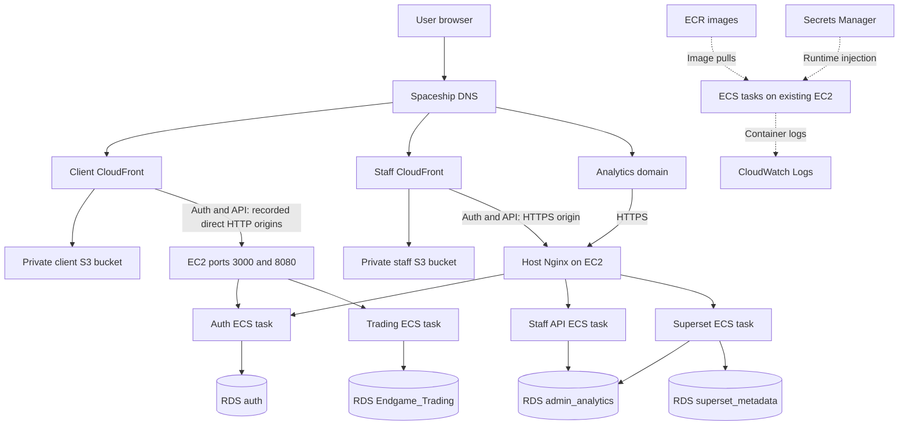
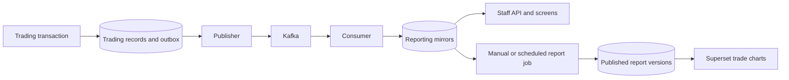

# How Asset Avengers moved to AWS

A teammate's walkthrough of the architecture, deployment decisions, problems and fixes.
Prepared from the repository and deployment records on October 29, 2026.

This explains **our actual deployment**. For reusable provisioning commands, use the
[local-to-AWS CLI handbook](local-to-aws-migration-guide.md). For routine operations,
use the [ECS runbook](../deployment/ecs/README.md).

**Status at the last recorded check:** we deliberately paused the application on
October 29 after successful runtime checks. All eight ECS services had desired
count zero, EC2 was stopped and RDS was stopped. This document does not claim the
APIs are currently serving traffic. The [pause receipt](../deployment/ecs/state/pause-state.json)
records the verification and RDS automatic restart time, November 5, 2026.
No cloud resources were started to write this explanation.

## A short explanation you can give the team

“We separated the application into hosting, compute and data. Angular builds are
stored in S3 and delivered through CloudFront. Backend services run as ECS tasks
on our existing EC2 server, using images stored in ECR. PostgreSQL lives in a
private RDS instance. DNS, certificates and Nginx connect the public domains to
the right services. Trading events flow through an outbox and Kafka into a
separate reporting database, which feeds the staff screens and Superset.

“We first got the application working with containers on EC2, repaired restored
database permissions and application integration issues, then migrated those
containers to ECS without resetting the databases. We chose ECS on EC2 to reuse
server capacity and keep the deployment inexpensive. That saves infrastructure
cost for our arrangement, but one server remains a single point of failure.”

## 1. What each piece does

| Piece | Its job in Asset Avengers | What it does not do |
| --- | --- | --- |
| Git repository | Stores source, deployment inputs and operational records | Pushing a commit alone does not deploy every component |
| Docker image | Packages a service and its runtime dependencies | It does not contain the live RDS databases |
| ECR | Stores versioned container images | It does not run containers |
| ECS | Starts, monitors and replaces tasks to meet a service's desired count | With EC2 capacity, it does not remove our responsibility for the server |
| EC2 | Supplies the CPU, memory, Docker runtime and ECS agent | It does not host our Angular frontend containers |
| RDS PostgreSQL | Stores persistent application and reporting data | It does not create users or load fixtures just because it starts |
| S3 | Stores the built Angular HTML, JavaScript, CSS and assets | It does not run our Java or Node backend |
| CloudFront | Delivers static assets and forwards configured API/auth paths | A working login page alone does not prove backend connectivity |
| Spaceship DNS | Points public hostnames at CloudFront or our origin IP | It does not proxy application requests itself |
| Elastic IP | Keeps the EC2 public address stable across normal stop/start | It does not make a single server highly available |
| Nginx | Terminates origin HTTPS and forwards requests to backend ports | It is host configuration, separate from old frontend-container Nginx files |
| ACM / Certbot | ACM supplies CloudFront viewer TLS; Certbot supplies host TLS | A viewer certificate and an origin certificate serve different connections |
| VPC, subnets and routes | Provide the network paths between EC2, RDS and the internet | Being in AWS does not automatically make every endpoint reachable |
| Security groups | Permit selected traffic, including EC2-to-RDS access | They do not replace application authorization |
| IAM | Authorizes AWS operations such as image pulls and secret reads | It is separate from PostgreSQL roles and application user roles |
| Secrets Manager | Holds runtime configuration; ECS injects referenced keys | Editing an old local .env does not update existing ECS tasks |
| CloudWatch Logs | Collects container logs for investigation | A quiet log window is not proof that every business workflow works |
| Kafka | Carries trading events to the reporting pipeline | It is not the authoritative financial database |
| Superset | Renders dashboards from permitted reporting datasets | It does not automatically publish reports or create missing trading data |

Region: us-east-1. Cluster: asset-avengers. Tag used for new taggable project
resources: project=asset-avengers.

## 2. How everything connects

The four database nodes are **logical databases on the same RDS instance**,
not four separately provisioned RDS servers. The APIs and workers in the diagram
share one EC2 host. The diagram separates them to show responsibilities.

### Public entry points and request paths

| Entry point | Static hosting or origin | Dynamic destination |
| --- | --- | --- |
| www.assetavengers.top | Client S3 through client CloudFront | /auth/* to auth port 3000; /api/* to trading port 8080 |
| admin.assetavengers.top | Staff S3 through shared staff CloudFront | /auth/* and /api/v1/* through HTTPS origin.assetavengers.top |
| analyst.assetavengers.top | Same staff build and distribution | Same backend routes; backend roles determine allowed access |
| analytics.assetavengers.top | Direct HTTPS to EC2 Nginx | Superset on host port 8088 |
| origin.assetavengers.top | EC2 Elastic IP 54.237.94.203 | Nginx sends /auth/ to 3000 and /api/v1/ to 8085 |

There is an intentional historical distinction in these records: the client
CloudFront backend origins used HTTP directly to the published ports, while the
staff distribution used HTTPS to Nginx. Migrating to ECS preserved that routing;
it did not silently convert the client to the newer ingress. HTTPS in the browser
and HTTPS between CloudFront and the origin are separate settings.

Staff root requests select /admin or /analyst based on hostname. Angular deep
links receive index.html. API/auth behaviors disable caching and preserve the
needed request headers, cookies, query strings and methods. They do not run the
Angular rewrite function. A 401 response is an authorization rejection; HTML
returned from an API path suggests incorrect routing.

The bucket origins are private and use CloudFront Origin Access Control. API
origins are backend services, not S3. See the original
[staff hosting record](../deployment/staff-cloudfront.md), whose pending-work
section describes an earlier stage; use the newer ECS and Superset records for
what was subsequently completed.

### What happens during login and a trading request

1. CloudFront loads the Angular application into the browser.
2. The browser sends a relative /auth/ request through its own site's routing.
3. Auth reads the auth database, checks credentials and policy, then issues the
   appropriate session/tokens. MFA and temporary-password rules are separate checks.
4. The client sends its token with a trading API request. The backend verifies
   identity and uses the stable user UUID to find or create that user's trading account.
5. Trading data is read or updated in Endgame_Trading. The browser's displayed
   balance is a view of persisted data, not the ledger itself.
6. Relevant committed changes enter the source outbox and later reach reporting.

An auth user is not automatically a funded trading account, an executed order,
or a published analytics row. Those are different records with different lifecycles.

### How the analyst reaches Superset

The analyst workspace has two related paths. Embedded dashboards use scoped
guest-token access; opening the Superset authoring workspace uses our custom SSO
handoff. For SSO, auth issues a short-lived, one-use ticket bound to the existing
application session. The browser posts that ticket to Superset, and Superset
exchanges it with auth over a server-side connection. Superset establishes its
own session for the mapped user and checks the application-session lease on
subsequent requests. It does not receive the user's password through this handoff.
The embedded viewer and authoring workspace have different authorization scopes.

### Where network and database protection fit

EC2 and RDS communicate through the VPC. RDS has a private endpoint, with database
access allowed from the application security group rather than from every browser.
Public traffic enters through the configured web origins and ports; the staff API,
Superset container port and Kafka do not have public security-group ingress.
A service can therefore be reachable on the host without exposing its port to
internet users. PostgreSQL credentials and object grants still apply after the
network connection succeeds. Auth also verifies its RDS TLS connection using the
AWS CA bundle; successful routing is separate from successful TLS and SQL access.

## 3. Why we chose this architecture

The objective was to get the full application onto AWS while keeping the
infrastructure inexpensive and preserving existing data.

- **ECS on EC2:** we already had an m6a.large server with capacity for the services.
  Reusing it avoided adding Fargate task compute while retaining a host for Kafka.
  Standard ECS on our customer-managed EC2 capacity has no separate orchestration
  fee; EC2 and the other resources still have charges. This is our cost rationale,
  not a universal claim that EC2 always beats Fargate for every workload.
- **No ALB:** Nginx on the one host already supplied the routing we needed.
  Another paid traffic distributor would not remove the single-host failure risk.
  Multiple hosts and stronger availability would justify revisiting this decision.
- **No NAT gateway:** the application host could reach AWS services from its
  public subnet, while database access stayed private. This avoided a separate
  NAT gateway for this arrangement.
- **S3 and CloudFront for Angular:** static builds do not need continuously running
  frontend containers. The EC2 capacity is used for APIs, workers, Kafka and Superset.
- **RDS outside application containers:** replacing an app task should not replace
  its database. One PostgreSQL instance holds four logical databases with distinct
  ownership and service permissions.
- **Six images, eight services:** the publisher, consumer and reporting scheduler
  share one pipeline image and select different commands. We did not need three
  separately maintained copies of that image.

The trade-offs are one host to patch and operate, finite shared CPU/memory,
local Kafka storage, no automatic host replacement and brief interruption during
some task replacements. This deployment is not a multi-host availability design.
We did not establish an exact monthly savings figure in the deployment records.

## 4. How we moved it, in order

### Stage A: establish a working cloud foundation

We identified the existing EC2, VPC, RDS and public-hosting configuration before
changing it. The application initially ran with Docker Compose on EC2. The
frontends were built and uploaded to S3, with CloudFront serving the domains.

RDS provided private PostgreSQL connectivity from EC2. The database separation
was preserved rather than merging unrelated application tables into one database.
The record confirms restored objects and later ownership repair; it does not
establish the exact original export/import command. The general handbook covers
native dump/restore choices without presenting an invented command as our history.

Secrets Manager supplied runtime settings. The earlier startup helper fetched
them and rewrote root .env; temporary manual edits could therefore disappear.

### Stage B: connect the browser, authentication and reporting

We configured staff host routing, an HTTPS Nginx origin and the correct CloudFront
API/auth behaviors. We checked service readiness independently of the browser,
then checked the public routes. Database access failures and empty account data
were investigated separately from connectivity.

We repaired restored object ownership and reporting access, addressed the dev
MFA inconsistency, and worked through catalogue, quote and logo integration.
We then exposed Superset over its own HTTPS hostname and connected its reporting
reader and SSO/embedding configuration.

### Stage C: move images to ECR, then processes to ECS

1. Built and published the service images into six ECR repositories, including
   the pipeline, Kafka and Superset images needed by the complete stack.
2. Used immutable image tags and recorded image digests. Task definitions pin
   digests so a deployment refers to a specific image artifact.
3. Registered the existing EC2 host with the ECS cluster and configured its agent.
4. Created task definitions containing ports, resource limits, commands, health
   checks, logging settings and secret references.
5. Preserved Kafka's existing persistent data path and made a verified backup.
6. Stopped the corresponding legacy containers before running their ECS replacements.
   Kept them stopped for rollback with automatic Docker restart disabled.
7. Started and verified dependencies and services without resetting RDS or rerunning
   Superset metadata initialization. Only one publisher, consumer and scheduler ran.
8. Added a guard so the old Compose start script cannot accidentally launch a
   duplicate production stack on the ECS-managed host.

Public domains and database endpoints did not need to change merely because ECS
replaced Compose. The application was moved in stages rather than replacing
hosting, networking, orchestration and data simultaneously.

### Stage D: verify, document and pause costs

The recorded checks found eight steady, healthy ECS services, working public
routing, a fresh reporting heartbeat and readable published report data. After
verification, we deliberately scaled services to zero and stopped EC2 and RDS.
Storage, retained IPs and other retained resources can still incur charges.

## 5. Problems we encountered and how we addressed them

### Restored tables had the wrong owner

**Symptom:** staff login returned 500, and auth logged “permission denied for table users.”
The database owner was correct, but restored tables still belonged to postgres.

**Fix:** transferred the auth application tables to natasha_auth and repaired
application object ownership in the other databases. Later checks included
schemas, views, functions, sequences where applicable, memberships and effective
permissions; database ownership alone was insufficient.

The large repair script did not produce the expected result during the original
attempt. Its exact failure mode was not established. Smaller scoped statements
and DO blocks, followed by catalog checks, were used instead. We did not solve it
by making every service an administrator or recreating the databases.

**Verification:** the reported auth table ownership and access checks succeeded;
the login error changed from a server error to invalid credentials. That proved
we had passed the permission failure, not that an application user existed.

### Auth tables were empty, and role names were being confused

**Symptom:** login still failed after the ownership repair; auth row counts were
reported as zero. An attempted membership grant also found that a suggested
reporting login did not exist.

**Fix:** treated application-account provisioning and PostgreSQL role creation as
separate tasks. Dev accounts were provisioned during the earlier application work.
The final documented reporting logins are tony_admin, bruce_etl and vision_reader;
old handoff names are not proof of deployed role existence.

| Database | Owner | Purpose |
| --- | --- | --- |
| Endgame_Trading | thor_trading | Trading records and transactional outbox |
| auth | natasha_auth | Authentication, sessions, MFA and password resets |
| admin_analytics | fury_reporting_owner | Staff projections and published reports |
| superset_metadata | jarvis_metadata | Superset configuration and metadata |

| Reporting login | Membership | Responsibility |
| --- | --- | --- |
| tony_admin | analytics_admin | Staff API access |
| bruce_etl | analytics_etl | Reporting pipeline writes and ETL |
| vision_reader | analytics_analyst | Superset reporting reads |

Permission groups, database login roles and application accounts are three
different things. See [RDS maintenance](../deployment/rds/README.md).

### MFA bypass passed one check but failed session creation

**Symptom:** after changing the dev super-admin password, login still returned
“MFA verification is required.”

**Fix in the code:** aligned the login exception and the final session-creation
check. The session repository rereads the locked user identity and recognizes the
same explicit dev allowlist when the flag is enabled. Password, disabled-account
and temporary-password restrictions still apply. Regression tests cover allowlisted
accounts and rejection outside that list.

The allowlist contains dev.superadmin@example.com, dev.admin@example.com and
dev.analyst@example.com. It does not include every account with a dev-looking name
or the client account merely because it is used for testing. The source labels this
a temporary local-development exception and defaults it off. This document does
not independently attest the current live secret value or recommend enabling it
for ordinary users. Passwords and encryption keys are deliberately omitted.

Sources: [bypass policy](../auth-server/src/auth/dev-mfa-bypass.ts),
[session enforcement](../auth-server/src/auth/sessions.repository.ts) and
[regression tests](../auth-server/src/auth/dev-mfa-bypass.spec.ts).

### Staff pages loaded, but that did not mean their APIs were connected

**Symptom:** static hosting worked while the staff backend was reachable only
through its host-side port arrangement. A frontend page could load without a
usable login/API route.

**Fix:** used origin.assetavengers.top, the stable EC2 IP, host Nginx and a Certbot
certificate. Staff CloudFront forwards /auth/* and /api/v1/* to that HTTPS origin.
Backend behaviors disable caching and omit the frontend rewrite function.

**Verification:** protected public endpoints returned expected 401 responses
without credentials, instead of connection errors or Angular HTML. Separate
application-login checks were still necessary.

### Staff clients/orders were empty or showed stale cash

**Symptom:** the staff screens showed no records, then a zero balance despite a
funded personal trading account. Creating an auth account did not by itself make
all reporting records appear.

**Architecture and remedy:** the staff API reads reporting projections, while the
trading API writes the source database. We worked through synchronization and
projection coverage rather than changing the user's money to match the display.
The current pipeline supports snapshots of existing source records, including
accounts, cash movements, holdings and instrument marks, plus ongoing outbox events.
Account snapshots carry account metadata and source balances.

The conversation records that this started working and that updates took time.
It does not preserve enough evidence to attribute every earlier zero display to
one exact defect. Diagnose identity/account selection and source-versus-projection
values before deciding a balance is missing. Normal ECS publisher startup does
**not** run a backfill; a historical backfill is a separate reviewed data operation.

### Stock searches failed for company names and common symbols

**Symptom:** searches for VOO, SPY, Walmart and Apple returned “Stock not found.”

**Fix represented in the repository:** maintain a local instrument catalogue,
including a reviewed Fauxnance universe import, and search saved metadata by
company name or ticker. Unknown-ticker discovery validates provider data before
creating an instrument. Quotes remain a separate dependency: a catalogue entry
is not a guarantee that a provider will return a usable quote at that moment.

The generic failure retry pause was shortened from five minutes to 30 seconds
in QuoteCache. Explicit provider rate-limit retry times remain respected. The
pause prevents repeated requests during a transient failure; reducing it lets
ordinary failures recover sooner without removing request-budget controls.

**Verification:** the recorded runtime checks found AAPL, SPY, VOO and WMT in the
catalogue. They did not execute purchases for every symbol. The evidence does not
pin every earlier SPY failure to the same cause.

Sources: [catalogue importer](../scripts/import-fauxnance-universe.py),
[quote cache](../backend/src/main/java/com/avengers/endgame/order/service/QuoteCache.java)
and [pricing documentation](pricing-cache.md).

### Stock logos were missing

**Fix:** the frontend build helper reads the LogoKit publishable-token setting
and generates an ignored configuration module. The component constructs ticker
or crypto image URLs and displays initials if the configuration or image fails.
The generated module is not committed to Git.

**Important distinction:** keeping the token out of Git does not hide a token
used by a browser image request. A user can inspect those requests. We did not
solve that by blocking developer tools or claiming the browser value was secret.

Sources: [build helper](../frontend/scripts/configure-logokit.mjs) and
[logo component](../frontend/src/app/client/components/instrument-logo/instrument-logo.ts).

### Superset opened, but bootstrap or charts did not work

**Symptoms:** the original bootstrap hit “permission denied for schema integration.”
After HTTPS and SSO worked, charts could still be empty.

**Fixes:** repaired the relevant reporting ownership/access and ran only the
reviewed bootstrap step needed for registration/configuration. Preserved existing
metadata, encryption keys and dashboard layouts. Configured analytics.assetavengers.top,
Nginx HTTPS, secure cookies and the allowed staff embedding origins.

The reader queries admin_analytics; superset_metadata stores dashboard configuration.
A reachable Superset login page and working SSO do not guarantee rows in a chart.
Trade dashboards require ingested facts, a published report batch, reader access
and matching filters. Synchronization alone does not publish the report.

**Verification:** the runtime record contains three dashboards, nine charts,
three embedded dashboards, a successful reader query and five published trades.
Earlier in the session the user confirmed SSO and charts worked. The final ECS
smoke test did not repeat an authenticated browser login or SSO handoff.

See [Superset deployment](../deployment/superset-aws.md) and
[dashboard semantics](admin-analytics/analyst-dashboard-guide.md).

### ECS required different networking and startup behavior than Compose

**Problem:** old Docker service names and Compose dependencies could not simply
be assumed to work unchanged across independent ECS tasks using bridge networking.
Kafka also advertises an address to its clients after their initial connection.

**Fix:** configured internal endpoints with the host's private IP and established
ports, including Kafka's advertised endpoint. Services are constrained to this
host, and Kafka retains its persistent directory. No public ingress was added for
Kafka, Superset's container port or the staff API port.

The pipeline image has an ENTRYPOINT selecting the pipeline program; ECS supplies
publisher, consumer or scheduler as the command. The ECS agent was configured for
the existing Ubuntu/systemd cgroup environment: task-level limits were disabled
for compatibility, while container memory limits/reservations remain. Host memory
was reserved rather than promising all RAM to tasks.

An earlier handoff reported a restarting publisher. The final evidence shows a
healthy publisher and drained pending outbox, but does not preserve a definitive
single cause for that original restart loop. Successful later operation is not a
reason to invent a missing root-cause analysis.

### Running both old and new stacks would cause conflicts

**Risk during migration:** duplicate services can contend for fixed ports; duplicate
publishers or schedulers can repeat work; two brokers must not own one data path.

**Fix:** stopped legacy containers first, disabled their restart policies and
retained them for rollback. Guarded the old startup helper. ECS now owns desired
service counts and replacement tasks. Web-task startup does not run database
resets, fixture loads or Superset initialization.

### A newer Superset version was not automatically a completed upgrade

We assessed a 6.1 candidate separately. Local migration/regression checks did not
establish that it was ready for production, and the candidate did not clear the
remaining critical findings. Production stayed on the recorded patched 6.0.0
image with the reviewed optional-feature safeguards. No production metadata
migration ran during the ECS move. Kafka received vendor OS updates; further
upgrades remain separate work. This was a reviewed deployment with documented
follow-ups, not a claim that every dependency issue had disappeared.

See the [upgrade decision](../deployment/ecs/superset-upgrade-review/README.md)
and the [operational limitations](../deployment/ecs/README.md#security-results-and-limits).

## 6. Why reporting takes time to update

The source transaction and reporting update are not one cross-database transaction.
The publisher waits for Kafka acknowledgement before marking an outbox event
published. The consumer deduplicates event IDs and commits projections before
advancing its offset. This supports retries without treating duplicate delivery
as a new financial action.

There are two different delays: current mirrors must ingest events, and report
charts must have a published batch covering the relevant facts. The report views
select the published batch for each report date; multiple dates can appear under
the chart's filters. They do not combine every historical rerun as extra copies
of the same trades. A newly registered user without published fills does not
appear in a trade chart merely because the auth row exists.

The source of truth for balances and execution remains Endgame_Trading. Reporting
can lag; it should not be used to overwrite source balances to make displays match.

## 7. What actually runs in ECS

| ECS service | Role | Host port | ECR image suffix |
| --- | --- | --- | --- |
| asset-avengers-auth | Login, sessions and MFA | 3000 | auth |
| asset-avengers-trading-api | Client accounts and trading | 8080 | trading-api |
| asset-avengers-staff-api | Admin/analyst endpoints | 8085 | staff-api |
| asset-avengers-superset | Dashboard application | 8088 | superset |
| asset-avengers-kafka | Event broker | 9092 | kafka |
| asset-avengers-publisher | Source outbox to Kafka | No public HTTP port | reporting-pipeline |
| asset-avengers-consumer | Kafka to reporting projections | No public HTTP port | reporting-pipeline |
| asset-avengers-reporting-job | Scheduling and report requests | No public HTTP port | reporting-pipeline |

Repository names start with asset-avengers/. Each task definition describes its
image digest, command, ports, resource settings, health check, logs and secret
references. An ECS service asks for a desired count of that task; the ECS agent
on EC2 carries out the scheduling decisions and starts containers through Docker.

The execution role permits startup operations such as pulling images and reading
the referenced secret; the task role is the application runtime's AWS identity.
PostgreSQL still applies the database login's own privileges independently.

## 8. How we checked it and what the checks prove

Recorded checks are dated October 29, 2026, before the deliberate shutdown.

| Evidence | Result | Limit |
| --- | --- | --- |
| ECS deployment verification | Eight steady services, healthy tasks, connected agent, project tags | Does not prove every user workflow |
| Public protected endpoints | Expected 401 responses for client/staff unauthenticated requests | Proves routing and rejection, not successful login |
| Browser smoke checks | Client, admin, analyst and Superset login pages loaded; tested frontend deep links | No authenticated login or SSO in this final test |
| Browser diagnostics | No JavaScript errors or failed application requests in inspected pages | Only the inspected pages and test window |
| Pipeline reads | Fresh heartbeat, zero pending outbox events at the check | A point-in-time observation, not a permanent guarantee |
| Superset reader query | Reporting read succeeded; five published trades | Does not assert all charts/filters contain data |
| Metadata checks | Three dashboards, nine charts, three embedded dashboard IDs | Not a complete visual comparison of every authored layout |
| Recent logs | No ERROR-level events in the inspected three-minute window | Not a full historical log audit |

No orders, money transfers, account changes or email requests were made in the
final smoke test. No EC2 reboot test was performed. No database reset, fixture
load, credential change or production metadata migration was part of the ECS move.
Earlier user confirmations of business functionality are useful history, but they
are not a substitute for a new authenticated end-to-end test after future changes.

Evidence: [deployment checks](../deployment/ecs/verification/deployment-verification.json),
[browser/data smoke checks](../deployment/ecs/verification/live-smoke-verification.json)
and [Superset checks](../deployment/ecs/verification/superset-runtime-verification.json).

## 9. How we start, stop and update it now

**Normal restart with desired counts still one:** start RDS and wait for available,
then start EC2 and wait for status checks and ECS agent connectivity. ECS restores
its services; verify readiness and public application behavior.

**Resume after our deliberate cost pause:** starting EC2 alone is insufficient,
because we saved all desired counts as zero. Start RDS, then EC2, then restore
Kafka's saved count and wait for health. Restore auth, the APIs and Superset,
then the publisher, consumer and reporting scheduler. Verify each layer. The
[runbook](../deployment/ecs/README.md#recorded-cost-pause) records the exact order.

Do not run the legacy start-project.sh on the ECS-managed host. Do not run schema
creation, account seeding, backfills or Superset bootstrap as routine startup.

**Backend release:** test code, build/push an image with a new immutable tag,
record its digest, register a task revision and update the matching ECS service.
The single-host fixed-port deployment can briefly stop that service during replacement.

**Frontend release:** build the Angular app, upload the appropriate static output
to its S3 bucket and invalidate affected CloudFront paths. An ECS backend deployment
does not automatically publish a new frontend build.

**Configuration release:** change only the reviewed secret/configuration keys and
replace affected tasks deliberately. Existing tasks do not automatically reread
Secrets Manager because a value changed. Preserve signing/encryption settings
unless a separate migration or rotation plan has been approved.

**Rollback:** preserve the known-good task revision and data. If reverting to a
legacy container, stop the ECS replacement and release its port first. Kafka and
worker rollback must preserve the single-broker/single-worker arrangement.
Rolling back an image does not undo database writes or schema changes.

Stopping compute is not deletion and is not a zero-cost guarantee. Retained EBS,
RDS storage/backups, Elastic IP, images, objects, logs and secrets can still cost
money. RDS can automatically restart after seven days; our recorded date is
November 5, 2026. Static pages may still load from CloudFront while APIs are paused.

## 10. Questions teammates are likely to ask

**“Are ECR and ECS the same thing?”** ECR stores image artifacts. ECS runs tasks
from those images on the EC2 capacity we supply.

**“Did we move the database into ECS?”** No. RDS remains the persistent PostgreSQL
service. Kafka uses its preserved host data path, which is a separate storage concern.

**“Why not just keep Compose?”** ECS gives us service desired counts, task revisions,
health-based replacement, deployment rollback controls and AWS-native logging and
secret injection. We still use Compose for isolated development/testing and retain
legacy definitions for reference and recovery.

**“Do we need a load balancer?”** The recorded one-host deployment works through
CloudFront and Nginx without an ALB. More hosts or availability requirements would
change that design discussion.

**“Why could login work while charts were empty?”** Login uses auth data. Charts
use reporting-reader permissions and published report facts. They have separate
connections, datasets and readiness conditions.

**“Why did changing table owners not create users?”** Ownership changes access to
existing objects. It does not insert data or provision application accounts.

**“Did a 200 health response prove everything worked?”** No. We checked network
routing, database permissions, reporting freshness and business data separately.

**“Does a Git push deploy the app?”** Not by itself. Use the actual image/service
or frontend publishing workflow. Do not assume a deployment pipeline exists just
because source and deployment files are committed.

**“Can another team copy our exact setup?”** They can follow the migration
handbook and adapt engine, ports, capacity, domains, secrets and availability needs.
Our service names, role names and single-host decisions are project-specific.

## Further reading

- [Reusable AWS CLI migration handbook](local-to-aws-migration-guide.md)
- [Current ECS deployment, rollback and resume instructions](../deployment/ecs/README.md)
- [Runtime entry point](../deployment/aws-runtime.md)
- [Database maintenance and ownership model](../deployment/rds/README.md)
- [Superset HTTPS, SSO and bootstrap record](../deployment/superset-aws.md)
- [Reporting database and eventual consistency](admin-analytics/database-guide.md)
- [Saved accounts and API behavior](persistence-and-api-usage.md)
- [Historical migration and repair records](../deployment/archive/README.md)
