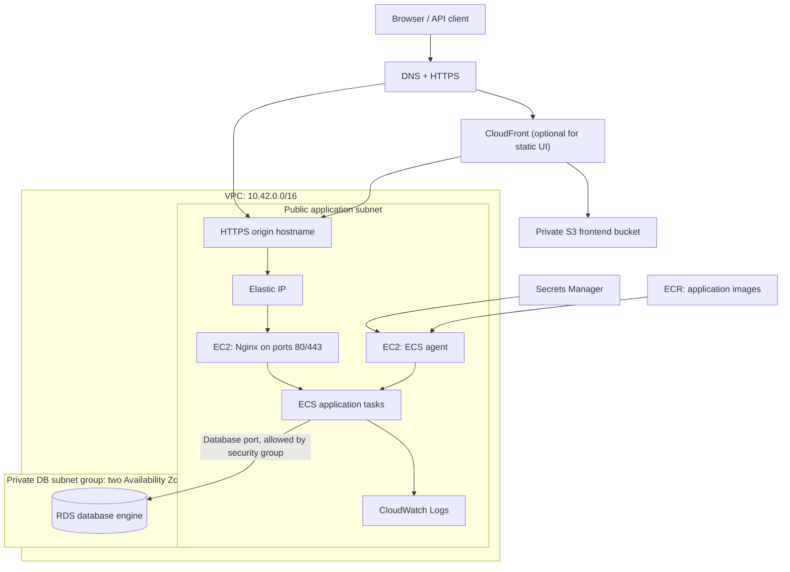
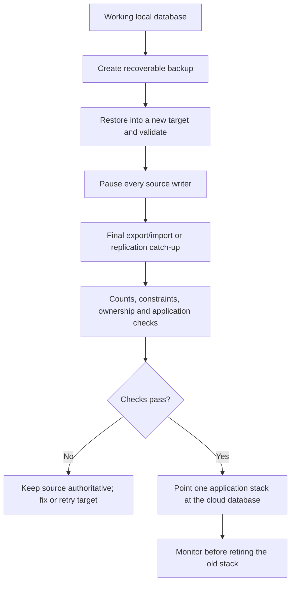

# From a local application to AWS: a CLI migration handbook

A reusable walkthrough, using Asset Avengers as a worked reference.
Documentation checked October 29, 2026.

This guide explains the services, the order to create them, the commands to use,
how to move existing data, and how to verify the result. It targets teams that
have a working local application but have not deployed it to AWS.

The main worked path is **Linux containers on ECS using one EC2 instance, private
RDS, an Elastic IP, Nginx/HTTPS, and optional S3/CloudFront frontend hosting**.
There is no required load balancer, NAT gateway, Kubernetes cluster, or Fargate
capacity in that path. Alternatives are marked explicitly.

**Read the whole sequence before executing it.** Creation commands create billable
resources. They are examples for a new environment, not an instruction to rebuild
the existing Asset Avengers environment. Replace example names, ports, domains,
sizes and versions. A database engine change is a separate application migration;
there is no one restore command that works for every database.


**Validation:** the Bash/Python/JSON examples and AWS CLI operation names were
checked locally; the Mermaid diagrams were rendered. Example infrastructure
creation and database imports were not executed as a new live deployment. Choose
real application inputs and rehearse migrations before production use.

## Contents

1. [Understand the services and the cost choices](#1-understand-the-services-and-the-cost-choices)
2. [Inventory the local application and choose a path](#2-inventory-the-local-application-and-choose-a-path)
3. [Prepare the CLI and working variables](#3-prepare-the-cli-and-working-variables)
4. [Create the VPC, subnets and routing](#4-create-the-vpc-subnets-and-routing)
5. [Create security groups](#5-create-security-groups)
6. [Create the cluster and EC2 instance role](#6-create-the-cluster-and-ec2-instance-role)
7. [Launch EC2 and attach an Elastic IP](#7-launch-ec2-and-attach-an-elastic-ip)
8. [Create private RDS](#8-create-private-rds)
9. [Move and verify the databases](#9-move-and-verify-the-databases)
10. [Build images and publish to ECR](#10-build-images-and-publish-to-ecr)
11. [Create application secrets and ECS roles](#11-create-application-secrets-and-ecs-roles)
12. [Register tasks and create ECS services](#12-register-tasks-and-create-ecs-services)
13. [Set up DNS, Nginx and HTTPS](#13-set-up-dns-nginx-and-https)
14. [Host static frontends in S3 and CloudFront](#14-host-static-frontends-in-s3-and-cloudfront)
15. [Move workers and stateful dependencies](#15-move-workers-and-stateful-dependencies)
16. [Verify, cut over and keep rollback possible](#16-verify-cut-over-and-keep-rollback-possible)
17. [Operate, pause and restart the environment](#17-operate-pause-and-restart-the-environment)
18. [Alternatives: no containers, Fargate and load balancers](#18-alternatives-no-containers-fargate-and-load-balancers)
19. [Asset Avengers worked reference](#19-asset-avengers-worked-reference)
20. [Troubleshooting and completion checklist](#20-troubleshooting-and-completion-checklist)
21. [Primary references](#21-primary-references)

## 1. Understand the services and the cost choices

### What each part does

| Term | Meaning | What it does in this deployment |
| --- | --- | --- |
| AWS account | Ownership and billing boundary | Holds the project's resources and permissions. |
| Region | Geographic AWS location, such as us-east-1 | Keep compute, RDS and ECR together unless there is a reason to separate them. |
| Availability Zone, or AZ | Separate infrastructure location inside a Region | Subnets belong to individual AZs; RDS subnet groups normally span at least two. |
| VPC | Your private network inside AWS | Contains EC2, private database addresses and routes. |
| CIDR | An address range, such as 10.42.0.0/16 | Divides the VPC into non-overlapping subnet ranges. |
| Subnet | An address range in one AZ | Places a resource in the public application tier or private database tier. |
| Route table | Rules deciding where network traffic goes | Gives public subnets a route to an internet gateway. |
| Internet gateway, or IGW | Connection between a VPC and the internet | Supports public EC2 connectivity when the instance also has a public address. |
| Security group | Stateful network access rules attached to resources | Allows HTTPS to the app and database access only from the application tier. |
| EC2 | A virtual server | Supplies CPU, RAM, operating system and disk for the containers. |
| EBS | Persistent block storage used by EC2 | Holds the OS and any deliberately persistent host files. |
| Elastic IP, or EIP | Reserved public IPv4 address | Keeps the server's public address stable across normal stop/start operations. |
| Docker image | Packaged application and runtime | Build output, not a running process or a database backup. |
| ECR | AWS container image registry | Stores versioned images that ECS can pull. It does not run them. |
| ECS cluster | Logical grouping of container compute and tasks | Registers our EC2 server and organizes the deployment. |
| ECS agent | Software on the EC2 host | Connects the server to ECS and starts/stops containers as instructed. |
| ECS task definition | Versioned container launch specification | Defines image digest, ports, memory, secrets, logging and startup command. |
| ECS task | A running copy of a task definition | Executes the actual process. |
| ECS service | Controller maintaining a desired number of tasks | Replaces failed tasks and performs deployments. |
| Fargate | AWS-managed compute for ECS tasks | Alternative to managing EC2 servers; billed for allocated task resources. |
| RDS | Managed relational database service | Runs supported database engines with managed storage and backups. |
| RDS DB instance | Managed database server | Can contain multiple logical databases where the engine supports them. |
| DB subnet group | Set of subnets RDS can use | Keeps database placement in the selected private tier. |
| Secrets Manager | Store for passwords, API keys and application secrets | ECS retrieves individual values at task startup. |
| IAM | AWS permissions and roles | Gives humans, EC2 and tasks their distinct AWS permissions. |
| Instance profile | Mechanism attaching an IAM role to EC2 | Lets the ECS/SSM agents use temporary AWS credentials. |
| Task execution role | Permissions used by ECS infrastructure | Pulls images, sends logs and retrieves task secrets. |
| Task role | Permissions available to application code | For example, access to an uploads bucket; unnecessary permissions stay absent. |
| Systems Manager, or SSM | Remote management service | Opens a server shell or a private database tunnel without public SSH. |
| CloudWatch Logs | Central application log storage | Collects container stdout/stderr; retention controls stored-log growth. |
| S3 | Object storage | Stores static frontend builds, uploads or protected migration backups. |
| CloudFront | Content delivery network and HTTPS entry point | Serves frontend assets and forwards selected API paths to the backend origin. |
| Origin | The server or bucket CloudFront fetches from | A private S3 bucket for assets; an HTTPS hostname for APIs. |
| OAC | CloudFront origin access control | Allows a private S3 bucket to serve CloudFront without becoming public. |
| CloudFront Function | Small request-time edge function | Rewrites frontend routes or selects the staff landing page. |
| DNS | Maps domain names to addresses or services | For example, origin.example.com to an Elastic IP. |
| Route 53 | AWS DNS service | Optional; an external DNS provider can remain authoritative. |
| ACM | AWS Certificate Manager | Provides certificates for CloudFront or a load balancer. |
| Nginx | Reverse proxy running on EC2 | Accepts HTTP/HTTPS and routes paths or hostnames to application ports. |
| Certbot / Let's Encrypt | Certificate automation for the host | Obtains and renews Nginx's HTTPS certificate. Not the same certificate as CloudFront's ACM certificate. |
| ALB | Application Load Balancer | Optional HTTP/HTTPS traffic distributor for multiple targets. |
| NAT gateway | Paid outbound path for resources in private subnets | Not required for this guide's public EC2 host; private compute needs an explicit egress design. |
| DMS | AWS Database Migration Service | Optional full-load and change-replication tooling for migrations needing less downtime. |

### Why Asset Avengers used ECS on EC2

Our objective was to keep the deployment inexpensive while moving the application
to AWS-managed container orchestration.

- We already had an EC2 server with enough capacity. ECS lets the APIs, auth,
  reporting workers and dashboard service share that server.
- Standard ECS on customer-managed EC2 has no separate ECS management charge.
  EC2, storage, logs and the other services still have their own charges.
- Moving applications to Fargate while retaining EC2 for Kafka would have added
  a second source of compute charges. Fargate can be a good choice for other teams;
  it is not automatically cheaper or more expensive for every workload.
- One server with Nginx did not require an ALB. Adding a load balancer alone would
  not protect us from that single server failing.
- A public application subnet with tightly controlled inbound access let the host
  reach ECR and other services without a NAT gateway. RDS stayed private.
- Static Angular builds went to S3/CloudFront, avoiding frontend containers on EC2.

The trade-off is explicit: one server must be maintained, has finite capacity,
and is a single point of failure. Fixed host ports also mean some deployments
briefly interrupt a service. For stronger availability, budget for multiple hosts
or tasks, appropriate load balancing, and durable shared/stateful storage.

This is a cost-oriented reference architecture, not a claim that every production
system should use one server. Compare current regional prices and the actual
requested CPU/RAM before choosing:
[AWS ECS pricing](https://aws.amazon.com/ecs/pricing/) and
[Fargate pricing](https://aws.amazon.com/fargate/pricing/).

### Target architecture



CloudFront is optional for an API-only or server-rendered application. Browsers
can use Nginx directly. A static S3 website cannot execute a server-rendered
Node/Python/Java application; that runtime belongs in a task or server process.

## 2. Inventory the local application and choose a path

Create an inventory before provisioning anything:

| Record | Questions to answer |
| --- | --- |
| Processes | What APIs, auth servers, workers, scheduled jobs and brokers run? |
| Start/build commands | What starts each process? Does it need a compilation step? |
| Ports | Which container port does each HTTP service listen on? |
| Data | Which databases, schemas, files, queues and Docker volumes contain real data? |
| Configuration | Which variables are secrets, URLs, database settings or feature flags? |
| Dependencies | Which services must be ready before another starts? |
| Platform | Linux or Windows? x86_64 or ARM64? |
| External services | Email, market data, payments, logos, callbacks or IP allowlists? |
| Health | What checks startup, readiness and actual database permissions? |
| Identity | Are users in your database, Cognito, or another identity provider? |
| Downtime | Can writes pause for a dump/restore, or is replication required? |

Run inspection commands in the **existing local project**, not a production shell:

```bash
git status --short
docker compose config --services
docker compose ps
docker volume ls
docker stats --no-stream
```

Inspect configuration locally without publishing rendered secrets. Do not paste
the output of an unfiltered `docker inspect` or `docker compose config`
into tickets or chat.

### Database choice: keep compatibility first

| Current database | Initial target / migration path |
| --- | --- |
| PostgreSQL | RDS PostgreSQL; native dump/restore for a manageable same-engine migration. |
| MySQL | RDS MySQL; logical dump/restore, supported backup import, or replication/DMS. |
| MariaDB | RDS MariaDB; engine-specific logical export or supported replication/DMS. |
| SQL Server | RDS SQL Server; native .bak restore through S3 after required option/IAM setup. |
| Oracle | RDS Oracle; Data Pump or a supported migration/replication workflow. |
| Db2 | RDS Db2; native migration tooling or DMS, subject to platform/version constraints. |
| SQLite | Keep it on durable single-host storage if appropriate, or plan schema/data/application conversion. It is not a PostgreSQL dump. |
| MongoDB | Evaluate a compatible MongoDB deployment, MongoDB Atlas or DocumentDB; verify feature compatibility. DocumentDB is not RDS and is not a universal drop-in replacement. |
| Redis / Valkey | Consider ElastiCache or another compatible deployment; determine whether it is a cache or authoritative data. |
| DynamoDB or other NoSQL | Use the appropriate native service/export/ETL workflow; do not apply RDS SQL commands. |
| No database | Skip the database creation/migration sections. |

The shared workflow applies to all these cases; the concrete database commands
must match the selected engine. This guide gives a complete PostgreSQL example,
a MySQL/MariaDB branch and links to the vendor-specific workflows for other engines.

### Container decision

- Already containerized: retain the application Dockerfiles, adapt configuration,
  and use ECR/ECS.
- Not containerized: either create and test a Dockerfile for each process, or use
  the non-container alternative in section 18. ECS runs containers, not a Git
  repository or a raw JAR directly.
- Windows-only dependencies: select Windows EC2/runtime/task settings. Do not
  execute this guide's Linux AMI/bootstrap commands unchanged.

```mermaid
flowchart LR
    Inventory["Inventory + decisions"] --> Network["VPC + subnets + routes"]
    Network --> Access["Security groups + IAM"]
    Access --> Compute["Cluster + EC2 + Elastic IP"]
    Compute --> Database["RDS + rehearsal migration"]
    Database --> Images["ECR + application configuration"]
    Images --> Runtime["ECS tasks + services"]
    Runtime --> Web["DNS + HTTPS + optional S3/CloudFront"]
    Web --> Cutover["Final sync + validation + cutover"]
    Cutover --> Operations["Backups + stop/start + deployments"]
```



## 3. Prepare the CLI and working variables

**Where:** your laptop/workstation, Bash on Linux or WSL. macOS users can use
Bash with equivalent installed tools. PowerShell needs translated quoting and
variable syntax; do not mix shells halfway through commands.

Install AWS CLI v2, jq, Python 3, Docker/buildx, Git, curl and the Session Manager
plugin. Install the database's native client tools before the migration section.

Use your OS-specific installers:
[AWS CLI v2](https://docs.aws.amazon.com/cli/latest/userguide/getting-started-install.html),
[Session Manager plugin](https://docs.aws.amazon.com/systems-manager/latest/userguide/session-manager-working-with-install-plugin.html),
and [Docker Engine](https://docs.docker.com/engine/install/).
For Windows, use WSL/Linux commands here or translate the workflow to PowerShell.
An AWS account and an organization-approved identity with the necessary deployment
permissions are prerequisites; account access is separate from database logins.

Run one block at a time and verify it before continuing. This is a walkthrough
with application-specific choices, not a single unattended shell script.

```bash
aws --version
aws configure list-profiles
aws configure sso --profile your-profile
aws sso login --profile your-profile
docker version
jq --version
python3 --version
```

If your organization supplies another authentication method, use that instead.
Do not assume a teammate's CLI profile exists on your machine.

Set the variables once in your main local terminal:

```bash
export AWS_PROFILE="your-profile"
export AWS_REGION="us-east-1"
export AWS_PAGER=""
PROJECT="myapp"
ENVIRONMENT="dev"
EXPECTED_ACCOUNT_ID="YOUR_12_DIGIT_ACCOUNT_ID"
SOURCE_DIR="/absolute/path/to/your/project"
WORK_DIR="/absolute/path/outside/git/myapp-migration"
APP_DOMAIN="app.example.com"
ORIGIN_DOMAIN="origin.example.com"

awsx() {
  aws --profile "$AWS_PROFILE" --region "$AWS_REGION" "$@"
}

ACCOUNT_ID=$(awsx sts get-caller-identity --query Account --output text)
test "$ACCOUNT_ID" = "$EXPECTED_ACCOUNT_ID" || {
  echo "Account mismatch: stop and select the intended AWS account." >&2
  exit 1
}

umask 077
mkdir -p "$WORK_DIR"
cd "$WORK_DIR"
```

Use names containing lowercase letters, digits and hyphens for the example
resource names. Replace all placeholders before proceeding. Record the generated
resource IDs and nonsecret variables in a private working note. Keep passwords,
secret JSON files, private keys and database dumps out of Git.

Every new taggable project resource should carry `project=myapp`. Asset
Avengers uses the same convention with `project=asset-avengers`.

Commands in later sections use the same local shell and variables unless the
block is explicitly marked **EC2 shell**, **SQL session**, or **second terminal**.
New terminal sessions do not inherit shell variables automatically.

**Verify:** the account ID is your intended account; Docker works; you can list
the chosen Region's AZs:

```bash
awsx ec2 describe-availability-zones \
  --filters Name=state,Values=available \
  --query 'AvailabilityZones[].{Name:ZoneName,ID:ZoneId}' --output table
```

## 4. Create the VPC, subnets and routing

Choose a CIDR that does not overlap your current VPCs, VPN or company network.
The following is an example, not a requirement to use these exact addresses.

| Subnet | Example CIDR | AZ | Route |
| --- | --- | --- | --- |
| Public application A | 10.42.1.0/24 | AZ A | Local VPC routes + internet gateway |
| Public application B | 10.42.2.0/24 | AZ B | Same; reserve for future expansion/optional ALB |
| Private database A | 10.42.11.0/24 | AZ A | Local VPC routes only |
| Private database B | 10.42.12.0/24 | AZ B | Local VPC routes only |

A subnet becomes public through routing; its name does not make it public.
An EC2 instance also needs a public address/EIP for this public-subnet path.
A private RDS database does not need a NAT gateway to receive connections from
EC2 in the same VPC. Private application servers that need internet egress are
a different design.

**Local terminal:**

```bash
AZ_A=$(awsx ec2 describe-availability-zones \
  --filters Name=state,Values=available \
  --query 'AvailabilityZones[0].ZoneName' --output text)
AZ_B=$(awsx ec2 describe-availability-zones \
  --filters Name=state,Values=available \
  --query 'AvailabilityZones[1].ZoneName' --output text)
test "$AZ_A" != "$AZ_B"

VPC_ID=$(awsx ec2 create-vpc --cidr-block 10.42.0.0/16 \
  --tag-specifications "ResourceType=vpc,Tags=[{Key=project,Value=$PROJECT}]" \
  --query Vpc.VpcId --output text)
awsx ec2 wait vpc-available --vpc-ids "$VPC_ID"
awsx ec2 modify-vpc-attribute --vpc-id "$VPC_ID" \
  --enable-dns-support '{"Value":true}'
awsx ec2 modify-vpc-attribute --vpc-id "$VPC_ID" \
  --enable-dns-hostnames '{"Value":true}'

PUBLIC_A=$(awsx ec2 create-subnet --vpc-id "$VPC_ID" \
  --availability-zone "$AZ_A" --cidr-block 10.42.1.0/24 \
  --tag-specifications "ResourceType=subnet,Tags=[{Key=project,Value=$PROJECT},{Key=Name,Value=$PROJECT-public-a}]" \
  --query Subnet.SubnetId --output text)
PUBLIC_B=$(awsx ec2 create-subnet --vpc-id "$VPC_ID" \
  --availability-zone "$AZ_B" --cidr-block 10.42.2.0/24 \
  --tag-specifications "ResourceType=subnet,Tags=[{Key=project,Value=$PROJECT},{Key=Name,Value=$PROJECT-public-b}]" \
  --query Subnet.SubnetId --output text)
PRIVATE_A=$(awsx ec2 create-subnet --vpc-id "$VPC_ID" \
  --availability-zone "$AZ_A" --cidr-block 10.42.11.0/24 \
  --tag-specifications "ResourceType=subnet,Tags=[{Key=project,Value=$PROJECT},{Key=Name,Value=$PROJECT-db-a}]" \
  --query Subnet.SubnetId --output text)
PRIVATE_B=$(awsx ec2 create-subnet --vpc-id "$VPC_ID" \
  --availability-zone "$AZ_B" --cidr-block 10.42.12.0/24 \
  --tag-specifications "ResourceType=subnet,Tags=[{Key=project,Value=$PROJECT},{Key=Name,Value=$PROJECT-db-b}]" \
  --query Subnet.SubnetId --output text)

IGW_ID=$(awsx ec2 create-internet-gateway \
  --tag-specifications "ResourceType=internet-gateway,Tags=[{Key=project,Value=$PROJECT}]" \
  --query InternetGateway.InternetGatewayId --output text)
awsx ec2 attach-internet-gateway --vpc-id "$VPC_ID" \
  --internet-gateway-id "$IGW_ID"

PUBLIC_RT=$(awsx ec2 create-route-table --vpc-id "$VPC_ID" \
  --tag-specifications "ResourceType=route-table,Tags=[{Key=project,Value=$PROJECT},{Key=Name,Value=$PROJECT-public}]" \
  --query RouteTable.RouteTableId --output text)
awsx ec2 create-route --route-table-id "$PUBLIC_RT" \
  --destination-cidr-block 0.0.0.0/0 --gateway-id "$IGW_ID"
for subnet in "$PUBLIC_A" "$PUBLIC_B"; do
  awsx ec2 associate-route-table --subnet-id "$subnet" \
    --route-table-id "$PUBLIC_RT"
done

PRIVATE_RT=$(awsx ec2 create-route-table --vpc-id "$VPC_ID" \
  --tag-specifications "ResourceType=route-table,Tags=[{Key=project,Value=$PROJECT},{Key=Name,Value=$PROJECT-private}]" \
  --query RouteTable.RouteTableId --output text)
for subnet in "$PRIVATE_A" "$PRIVATE_B"; do
  awsx ec2 associate-route-table --subnet-id "$subnet" \
    --route-table-id "$PRIVATE_RT"
done
```

**Verify:** only the public route table has an internet default route:

```bash
awsx ec2 describe-route-tables \
  --filters "Name=vpc-id,Values=$VPC_ID" \
  --query 'RouteTables[].{ID:RouteTableId,Routes:Routes,Subnets:Associations[].SubnetId}' \
  --output json
```

## 5. Create security groups

This example exposes Nginx on 80/443, uses SSM for administration, and does not
open application ports or the database to the internet.

| Connection | Destination | Allowed source |
| --- | --- | --- |
| HTTP/HTTPS | EC2, ports 80/443 | Public viewers, or a deliberately restricted origin design |
| SSH, if selected | EC2, port 22 | Your current administrator IP /32 only |
| PostgreSQL example | RDS, port 5432 | Application EC2 security group |
| Other database | RDS, selected engine port | Application tier security group |
| Internal app/broker ports | EC2 | Not opened publicly in this design |

Default security-group outbound rules allow egress. If your organization restricts
egress, add the required DNS, HTTPS/provider and database paths deliberately.
Security groups do not replace route tables.

```bash
DB_ENGINE="postgres"
DB_PORT="5432"

APP_SG=$(awsx ec2 create-security-group \
  --group-name "$PROJECT-app" --description "Application ingress" \
  --vpc-id "$VPC_ID" \
  --tag-specifications "ResourceType=security-group,Tags=[{Key=project,Value=$PROJECT}]" \
  --query GroupId --output text)
DB_SG=$(awsx ec2 create-security-group \
  --group-name "$PROJECT-db" --description "Database from application tier" \
  --vpc-id "$VPC_ID" \
  --tag-specifications "ResourceType=security-group,Tags=[{Key=project,Value=$PROJECT}]" \
  --query GroupId --output text)

awsx ec2 authorize-security-group-ingress --group-id "$APP_SG" \
  --protocol tcp --port 80 --cidr 0.0.0.0/0
awsx ec2 authorize-security-group-ingress --group-id "$APP_SG" \
  --protocol tcp --port 443 --cidr 0.0.0.0/0
awsx ec2 authorize-security-group-ingress --group-id "$DB_SG" \
  --protocol tcp --port "$DB_PORT" --source-group "$APP_SG"
```

For MySQL/MariaDB use 3306; SQL Server commonly uses 1433; Oracle commonly uses
1521; Db2 commonly uses 50000. Confirm your actual selected engine/port.

Optional SSH access, if you choose it instead of or alongside SSM:

```bash
ADMIN_CIDR="$(curl -fsS https://checkip.amazonaws.com)/32"
awsx ec2 authorize-security-group-ingress --group-id "$APP_SG" \
  --protocol tcp --port 22 --cidr "$ADMIN_CIDR"
awsx ec2 create-key-pair --key-name "$PROJECT-ssh" \
  --key-type ed25519 \
  --tag-specifications "ResourceType=key-pair,Tags=[{Key=project,Value=$PROJECT}]" \
  --query KeyMaterial --output text > "$WORK_DIR/ec2-key.pem"
chmod 400 "$WORK_DIR/ec2-key.pem"
```

That redirects private key material into a protected local file. Do not commit it.
If using this optional key, add its name to the launch template in the next section.

**Verify:** RDS allows the application security group, not 0.0.0.0/0:

```bash
awsx ec2 describe-security-groups --group-ids "$APP_SG" "$DB_SG" \
  --query 'SecurityGroups[].{ID:GroupId,Inbound:IpPermissions}' --output json
```

## 6. Create the cluster and EC2 instance role

A cluster does not create compute by itself. EC2 supplies that compute; the
instance role lets its agents communicate with ECS and Systems Manager.

For the ECS path:

```bash
CLUSTER="$PROJECT"
HOST_ROLE="$PROJECT-ec2"
HOST_PROFILE="$PROJECT-ec2"

awsx ecs create-cluster --cluster-name "$CLUSTER" \
  --tags "key=project,value=$PROJECT" > "$WORK_DIR/cluster.json"

cat > "$WORK_DIR/ec2-trust.json" <<'JSON'
{
  "Version": "2012-10-17",
  "Statement": [{
    "Effect": "Allow",
    "Principal": {"Service": "ec2.amazonaws.com"},
    "Action": "sts:AssumeRole"
  }]
}
JSON

awsx iam create-role --role-name "$HOST_ROLE" \
  --assume-role-policy-document "file://$WORK_DIR/ec2-trust.json" \
  --tags "Key=project,Value=$PROJECT" > "$WORK_DIR/host-role.json"
awsx iam attach-role-policy --role-name "$HOST_ROLE" \
  --policy-arn arn:aws:iam::aws:policy/service-role/AmazonEC2ContainerServiceforEC2Role
awsx iam attach-role-policy --role-name "$HOST_ROLE" \
  --policy-arn arn:aws:iam::aws:policy/AmazonSSMManagedInstanceCore
awsx iam create-instance-profile --instance-profile-name "$HOST_PROFILE" \
  --tags "Key=project,Value=$PROJECT" > "$WORK_DIR/host-profile.json"
awsx iam add-role-to-instance-profile --instance-profile-name "$HOST_PROFILE" \
  --role-name "$HOST_ROLE"
```

For a non-container server, the ECS policy and cluster are unnecessary; retain
the SSM profile and use the non-container branch later.

IAM changes can take time to propagate. If launch reports an invalid instance
profile immediately after creation, verify the profile and retry after propagation.
Do not replace credentials or create a second unrelated role to work around it.

```bash
awsx iam get-instance-profile --instance-profile-name "$HOST_PROFILE" \
  --query 'InstanceProfile.{Name:InstanceProfileName,Roles:Roles[].RoleName}'
```

## 7. Launch EC2 and attach an Elastic IP

### Choose an AMI and capacity

For a new Linux ECS host, use the ECS-optimized Amazon Linux 2023 AMI. It includes
Docker and the ECS agent. Asset Avengers reused an existing Ubuntu server and
installed the agent separately; a new team does not need to copy that exception.

Choose x86_64 or ARM64 consistently across AMI, instance type and image build.
The example below is x86_64. Size from measured workloads and startup peaks,
not just the number of containers.

```bash
AMI_ID=$(awsx ssm get-parameter \
  --name /aws/service/ecs/optimized-ami/amazon-linux-2023/recommended/image_id \
  --query Parameter.Value --output text)
ROOT_DEVICE=$(awsx ec2 describe-images --image-ids "$AMI_ID" \
  --query 'Images[0].RootDeviceName' --output text)
INSTANCE_TYPE="m6a.large"

awsx ec2 describe-instance-type-offerings --location-type region \
  --filters "Name=instance-type,Values=$INSTANCE_TYPE" \
  --query 'InstanceTypeOfferings[].InstanceType' --output text
```

For ARM, select the corresponding arm64 ECS AMI parameter, compatible instance
type and linux/arm64 image platform. Windows workloads need a Windows-specific
AMI/task procedure.

### Create a launch template

User data is first-boot configuration, not secret storage:

```bash
cat > "$WORK_DIR/user-data.sh" <<BOOT
#!/bin/bash
set -eu
mkdir -p /etc/ecs
cat > /etc/ecs/ecs.config <<ECSCONFIG
ECS_CLUSTER=$CLUSTER
ECS_ENABLE_AWSLOGS_EXECUTIONROLE_OVERRIDE=true
ECS_AVAILABLE_LOGGING_DRIVERS=["json-file","awslogs"]
ECS_RESERVED_MEMORY=512
ECSCONFIG
systemctl enable --now --no-block ecs
systemctl enable --now amazon-ssm-agent
BOOT

USER_DATA_B64=$(base64 < "$WORK_DIR/user-data.sh" | tr -d '\n')

jq -n --arg ami "$AMI_ID" --arg type "$INSTANCE_TYPE" \
  --arg profile "$HOST_PROFILE" --arg sg "$APP_SG" \
  --arg root "$ROOT_DEVICE" --arg data "$USER_DATA_B64" \
  --arg project "$PROJECT" \
  '{
    ImageId:$ami, InstanceType:$type,
    IamInstanceProfile:{Name:$profile},
    SecurityGroupIds:[$sg], UserData:$data,
    MetadataOptions:{
      HttpTokens:"required",HttpEndpoint:"enabled",HttpPutResponseHopLimit:2
    },
    BlockDeviceMappings:[{
      DeviceName:$root,
      Ebs:{VolumeSize:30,VolumeType:"gp3",Encrypted:true,DeleteOnTermination:true}
    }],
    TagSpecifications:[
      {ResourceType:"instance",Tags:[{Key:"project",Value:$project}]},
      {ResourceType:"volume",Tags:[{Key:"project",Value:$project}]}
    ]
  }' > "$WORK_DIR/launch-template.json"

LAUNCH_TEMPLATE_ID=$(awsx ec2 create-launch-template \
  --launch-template-name "$PROJECT-host" \
  --version-description initial \
  --launch-template-data "file://$WORK_DIR/launch-template.json" \
  --tag-specifications "ResourceType=launch-template,Tags=[{Key=project,Value=$PROJECT}]" \
  --query LaunchTemplate.LaunchTemplateId --output text)
```

If you created an SSH key, add `KeyName` with that key's name to
`launch-template.json` **before** creating the launch template. Otherwise use SSM.

This example root disk is deleted on instance termination. It survives a normal
stop/start. Do not keep the only copy of database or uploaded-user data there.
Section 15 covers separate persistent storage.

### Launch, associate the EIP, and verify

```bash
INSTANCE_ID=$(awsx ec2 run-instances \
  --launch-template "LaunchTemplateId=$LAUNCH_TEMPLATE_ID,Version=1" \
  --subnet-id "$PUBLIC_A" \
  --query 'Instances[0].InstanceId' --output text)
awsx ec2 wait instance-running --instance-ids "$INSTANCE_ID"

EIP_ALLOCATION_ID=$(awsx ec2 allocate-address --domain vpc \
  --tag-specifications "ResourceType=elastic-ip,Tags=[{Key=project,Value=$PROJECT}]" \
  --query AllocationId --output text)
awsx ec2 associate-address --allocation-id "$EIP_ALLOCATION_ID" \
  --instance-id "$INSTANCE_ID"
ELASTIC_IP=$(awsx ec2 describe-addresses --allocation-ids "$EIP_ALLOCATION_ID" \
  --query 'Addresses[0].PublicIp' --output text)

awsx ec2 wait instance-status-ok --instance-ids "$INSTANCE_ID"
awsx ssm describe-instance-information \
  --filters "Key=InstanceIds,Values=$INSTANCE_ID" \
  --query 'InstanceInformationList[].{ID:InstanceId,Ping:PingStatus}' --output table
awsx ecs list-container-instances --cluster "$CLUSTER"
```

An EIP is not a database address. Applications use the RDS DNS endpoint for
database connections. An allocated public IPv4 address can incur charges even
when EC2 is stopped.

Check registration details, and tag the ECS container-instance resource:

```bash
CONTAINER_INSTANCE_ARN=$(awsx ecs list-container-instances --cluster "$CLUSTER" \
  --query 'containerInstanceArns[0]' --output text)
test "$CONTAINER_INSTANCE_ARN" != "None"
awsx ecs describe-container-instances --cluster "$CLUSTER" \
  --container-instances "$CONTAINER_INSTANCE_ARN" \
  --query 'containerInstances[].{Connected:agentConnected,Status:status,Free:remainingResources}'
awsx ecs tag-resource --resource-arn "$CONTAINER_INSTANCE_ARN" \
  --tags "key=project,value=$PROJECT"
```

If no instance registers, check the cluster name, instance role, internet egress,
and agent logs before creating application services.

Open an EC2 shell:

```bash
awsx ssm start-session --target "$INSTANCE_ID"
```

**Inside the EC2 shell**, verify:

```bash
sudo systemctl is-active ecs
sudo systemctl is-enabled ecs
sudo docker ps
sudo journalctl -u ecs --no-pager -n 30
```

SSM's remote-host port forwarding in the next section needs a recent SSM agent
and the Session Manager plugin on the workstation.

### Existing Ubuntu EC2 host: the path Asset Avengers used

This is an **alternative to launching a new ECS-optimized host**, not an extra
required server. Inventory the existing host, its role, Docker, disk and active
processes first. Preserve existing role permissions and local changes.

**Local terminal**, after selecting the actual existing instance:

```bash
EXISTING_INSTANCE_ID="REPLACE_WITH_EXISTING_INSTANCE_ID"
PROFILE_ARN=$(awsx ec2 describe-instances --instance-ids "$EXISTING_INSTANCE_ID" \
  --query 'Reservations[0].Instances[0].IamInstanceProfile.Arn' --output text)
test "$PROFILE_ARN" != None || {
  echo "No instance profile: use the create/associate profile branch first." >&2
  exit 1
}
PROFILE_NAME=$(printf '%s' "$PROFILE_ARN" | awk -F/ '{print $NF}')
EXISTING_ROLE=$(awsx iam get-instance-profile --instance-profile-name "$PROFILE_NAME" \
  --query 'InstanceProfile.Roles[0].RoleName' --output text)
awsx iam get-role --role-name "$EXISTING_ROLE"
awsx iam list-attached-role-policies --role-name "$EXISTING_ROLE"

awsx iam attach-role-policy --role-name "$EXISTING_ROLE" \
  --policy-arn arn:aws:iam::aws:policy/service-role/AmazonEC2ContainerServiceforEC2Role
```

If no profile exists, create a reviewed instance profile as in section 6 and
associate it with the existing instance:

```bash
awsx ec2 associate-iam-instance-profile --instance-id "$EXISTING_INSTANCE_ID" \
  --iam-instance-profile "Name=$HOST_PROFILE"
```

Do not replace an existing secret-access profile unnecessarily.

**Existing Ubuntu EC2 shell**, for the x86_64 example, with Docker already
installed and no conflicting ECS registration:

```bash
uname -m
docker version
docker info --format 'cgroup={{.CgroupDriver}} version={{.CgroupVersion}}'
sudo systemctl is-active ecs || true

sudo mkdir -p /etc/ecs
if sudo test -e /etc/ecs/ecs.config; then
  echo "Existing ECS config found: review/merge it before continuing." >&2
  exit 1
fi
printf '%s\n' \
  'ECS_CLUSTER=myapp' \
  'ECS_ENABLE_AWSLOGS_EXECUTIONROLE_OVERRIDE=true' \
  'ECS_AVAILABLE_LOGGING_DRIVERS=["json-file","awslogs"]' \
  'ECS_RESERVED_MEMORY=512' |
  sudo tee /etc/ecs/ecs.config >/dev/null

curl -fsSL \
  https://s3.us-east-1.amazonaws.com/amazon-ecs-agent-us-east-1/amazon-ecs-init-latest.amd64.deb \
  -o /tmp/amazon-ecs-init.amd64.deb
sudo dpkg -i /tmp/amazon-ecs-init.amd64.deb
sudo systemctl enable --now ecs
sudo systemctl status ecs --no-pager
```

Replace myapp with the intended cluster. If an ECS configuration already exists,
review/merge it instead of overwriting it. ARM hosts need the matching package.

The ECS agent's task-level resource-limit support depends on the host/cgroup
configuration. On our existing Ubuntu/systemd-cgroup host we set
ECS_ENABLE_TASK_CPU_MEM_LIMIT=false, retained per-container memory limits, and
reserved additional host memory rather than restarting Docker during migration.
Do not apply that exception to every new ECS-optimized host.

Verify registration with the same ECS inspection/tagging commands from section 7.
Registering the host does not adopt existing Compose containers as ECS tasks:
publish images and perform a staged service cutover, retaining stopped rollback
containers until acceptance.


## 8. Create private RDS

Skip this section if there is no relational database or your selected target is
not RDS. Do not move a locally running PostgreSQL/MySQL container into a task just
to preserve its filesystem; use the database migration process.

### Choose the compatible engine version and class

This executable example is PostgreSQL. For another engine, change engine,
version, class, port, license/option settings and import method together.

```bash
DB_ID="$PROJECT-db"
DB_NAME="appdb"
DB_ADMIN_USER="dbadmin"
DB_CLASS="db.t4g.micro"

awsx rds describe-db-engine-versions --engine "$DB_ENGINE" \
  --query 'DBEngineVersions[].{Version:EngineVersion,Status:Status}' --output table
```

Choose a supported target version compatible with the source and extensions.
Do not downgrade a source database by restoring it into an older target.

```bash
ENGINE_VERSION="REPLACE_WITH_A_SUPPORTED_COMPATIBLE_VERSION"
awsx rds describe-orderable-db-instance-options \
  --engine "$DB_ENGINE" --engine-version "$ENGINE_VERSION" \
  --db-instance-class "$DB_CLASS" \
  --query 'OrderableDBInstanceOptions[].{Class:DBInstanceClass,Storage:StorageType}' \
  --output table
```

A tiny database class is a development starting point, not a production sizing
promise. Check measured memory, connections, I/O and import workload.

### Create the DB subnet group and server

The two private subnets must be in different AZs, even for the ordinary Single-AZ
RDS path. Do not confuse a subnet group spanning two AZs with actually purchasing
a Multi-AZ database deployment.

```bash
awsx rds create-db-subnet-group \
  --db-subnet-group-name "$PROJECT-db-subnets" \
  --db-subnet-group-description "Private database subnets" \
  --subnet-ids "$PRIVATE_A" "$PRIVATE_B" \
  --tags "Key=project,Value=$PROJECT" > "$WORK_DIR/db-subnets.json"

awsx rds create-db-instance \
  --db-instance-identifier "$DB_ID" \
  --engine "$DB_ENGINE" --engine-version "$ENGINE_VERSION" \
  --db-instance-class "$DB_CLASS" --allocated-storage 20 \
  --storage-type gp3 --storage-encrypted \
  --master-username "$DB_ADMIN_USER" --manage-master-user-password \
  --db-name "$DB_NAME" --port "$DB_PORT" \
  --db-subnet-group-name "$PROJECT-db-subnets" \
  --vpc-security-group-ids "$DB_SG" \
  --no-publicly-accessible --no-multi-az \
  --backup-retention-period 7 --copy-tags-to-snapshot \
  --tags "Key=project,Value=$PROJECT" > "$WORK_DIR/rds-created.json"

awsx rds wait db-instance-available --db-instance-identifier "$DB_ID"
RDS_ENDPOINT=$(awsx rds describe-db-instances \
  --db-instance-identifier "$DB_ID" \
  --query 'DBInstances[0].Endpoint.Address' --output text)
export RDS_ADMIN_SECRET_ARN=$(awsx rds describe-db-instances \
  --db-instance-identifier "$DB_ID" \
  --query 'DBInstances[0].MasterUserSecret.SecretArn' --output text)

awsx rds describe-db-instances --db-instance-identifier "$DB_ID" \
  --query 'DBInstances[].{Status:DBInstanceStatus,Endpoint:Endpoint.Address,Public:PubliclyAccessible,Subnets:DBSubnetGroup.Subnets[].SubnetIdentifier}' \
  --output json
```

The managed master password is stored in Secrets Manager. No password is passed
as a shell command argument. The application will use its own login, not the
master user. Some engines/editions need additional creation parameters; verify
their engine-specific documentation rather than reusing this PostgreSQL command.

For a new availability-oriented deployment, consider Multi-AZ instead of the
example's Single-AZ choice. That changes cost and resilience, not whether private
subnets are still required.

## 9. Move and verify the databases

### 9.1 Choose the migration method

| Situation | Usually start with | Why |
| --- | --- | --- |
| Small/medium same-engine database; planned downtime is acceptable | Native logical dump and restore | Easy to rehearse and inspect; includes engine-specific schema objects. |
| Large database with a supported physical import path | Engine-native backup/import | Often faster; support differs by engine and version. |
| Minimal write downtime required | Supported replication or DMS full-load + CDC | Copies initial data, then catches up changes before cutover. |
| Changing database engines | Schema conversion + data migration + application testing | SQL, types, functions and transaction behavior can differ. |
| Moving several related databases | One coordinated write-freeze and migration plan | Independent dumps do not automatically form a cross-database snapshot. |

**Default for a small project like Asset Avengers:** rehearse a native,
same-engine migration into a new target, then perform a final export while all
writers are paused. Do not replace a data migration with demo fixtures.

A database being available is not proof that its tables, owners, users, views,
sequences or data were restored.



### 9.2 Establish a private connection to RDS

Do not make RDS public just to import data from your laptop.

Options are:

1. Run the database client on EC2 and transfer a protected dump there.
2. Use a trusted VPN/private network.
3. Use SSM remote-host port forwarding through EC2.

The following uses option 3. In a **second local terminal**, supply the nonsecret
values obtained earlier and keep the session open:

```bash
AWS_PROFILE="your-profile"
AWS_REGION="us-east-1"
INSTANCE_ID="REPLACE_WITH_YOUR_INSTANCE_ID"
RDS_ENDPOINT="REPLACE_WITH_YOUR_RDS_ENDPOINT"
DB_PORT="5432"

aws --profile "$AWS_PROFILE" --region "$AWS_REGION" ssm start-session \
  --target "$INSTANCE_ID" \
  --document-name AWS-StartPortForwardingSessionToRemoteHost \
  --parameters "{\"host\":[\"$RDS_ENDPOINT\"],\"portNumber\":[\"$DB_PORT\"],\"localPortNumber\":[\"15432\"]}"
```

EC2 must resolve/reach RDS, SSM must be online, and the RDS security group must
allow the EC2 security group. Port 15432 is a local tunnel endpoint; RDS still
listens on its configured database port.

**Back in the main local terminal:**

```bash
curl -fsS "https://truststore.pki.rds.amazonaws.com/$AWS_REGION/$AWS_REGION-bundle.pem" \
  -o "$WORK_DIR/rds-ca.pem"
```

For PostgreSQL, combine the real hostname with the tunnel's socket address:

```bash
export PGHOST="$RDS_ENDPOINT"
export PGHOSTADDR="127.0.0.1"
export PGPORT="15432"
export PGDATABASE="$DB_NAME"
export PGSSLMODE="verify-full"
export PGSSLROOTCERT="$WORK_DIR/rds-ca.pem"
```

`PGHOSTADDR` sends the connection through localhost while `PGHOST` supplies
the expected server identity for TLS. Other database clients have different
settings; do not assume PostgreSQL environment variables configure MySQL, Java
JDBC or a Node.js database driver.

### 9.3 PostgreSQL: inspect and export the source

**Local terminal, source connection parameters specified explicitly:**

```bash
LOCAL_DB_HOST="127.0.0.1"
LOCAL_DB_PORT="5432"
LOCAL_DB_USER="your_local_export_user"
LOCAL_DB_NAME="your_local_database"

pg_dump --version
env -u PGHOSTADDR -u PGSSLROOTCERT PGSSLMODE=prefer \
  psql --host="$LOCAL_DB_HOST" --port="$LOCAL_DB_PORT" \
  --username="$LOCAL_DB_USER" --dbname="$LOCAL_DB_NAME" --password \
  --command="SELECT current_database(), current_user, version();"

env -u PGHOSTADDR -u PGSSLROOTCERT PGSSLMODE=prefer \
  pg_dump --host="$LOCAL_DB_HOST" --port="$LOCAL_DB_PORT" \
  --username="$LOCAL_DB_USER" --dbname="$LOCAL_DB_NAME" --password \
  --format=custom --file="$WORK_DIR/app.dump"

pg_restore --list "$WORK_DIR/app.dump" > "$WORK_DIR/app.dump.list"
sha256sum "$WORK_DIR/app.dump" > "$WORK_DIR/app.dump.sha256"
```

The source commands above deliberately clear the target tunnel address and
RDS CA variables. The prefer setting is for this loopback/local development
example; a remote source needs its own appropriate TLS/CA configuration. Do not
let target RDS client settings silently change how you connect to the source.

Use a dump client compatible with the source server, and a restore tool/target
compatible with that archive. Inspect extensions, large objects, functions,
triggers, materialized views and schema ownership. A PostgreSQL data-directory
copy is not a portable RDS import.

If the source runs in Docker, either expose it only to a local database client
or execute its existing matching client, for example:

```bash
SOURCE_DB_CONTAINER="your-local-postgres-container"
docker exec "$SOURCE_DB_CONTAINER" \
  pg_dump -U "$LOCAL_DB_USER" -d "$LOCAL_DB_NAME" -Fc \
  > "$WORK_DIR/app.dump"
pg_restore --list "$WORK_DIR/app.dump" > "$WORK_DIR/app.dump.list"
```

The container example relies on the container's already configured local
authentication. Do not add passwords to the command line to make it work.

A rehearsal dump can be made while the source is in use. For the final cutover,
pause APIs, workers, cron jobs, import tools and other writers first. A consistent
dump is still stale if the old application continues writing afterward.

### 9.4 PostgreSQL: connect as the managed RDS administrator without printing its password

The following helper retrieves the managed master secret in memory and launches
a PostgreSQL client. It does not print the secret or put it in command arguments.
This helper belongs in the private migration workspace, not an image or Git.

```bash
cat > "$WORK_DIR/with-rds-admin.py" <<'PY'
import json
import os
import subprocess
import sys

command = [
    "aws", "--profile", os.environ["AWS_PROFILE"],
    "--region", os.environ["AWS_REGION"],
    "secretsmanager", "get-secret-value",
    "--secret-id", os.environ["RDS_ADMIN_SECRET_ARN"],
    "--output", "json",
]
result = subprocess.run(command, capture_output=True, text=True)
if result.returncode:
    raise SystemExit("Cannot retrieve the administrator secret; output withheld")
credentials = json.loads(json.loads(result.stdout)["SecretString"])
environment = os.environ.copy()
environment["PGUSER"] = credentials["username"]
environment["PGPASSWORD"] = credentials["password"]
raise SystemExit(subprocess.call(sys.argv[1:], env=environment))
PY

python3 "$WORK_DIR/with-rds-admin.py" \
  psql -X --dbname=postgres -v ON_ERROR_STOP=1 \
  --command="SELECT current_database(), current_user;"
```

The AWS identity running this helper needs permission to read that administrator
secret. The EC2 application role and ordinary application tasks do not need it.

### 9.5 PostgreSQL: prepare ownership before restoring

For a **new, empty target with one application ownership boundary**, the example
uses a non-login owner and a separate runtime login:

```bash
python3 "$WORK_DIR/with-rds-admin.py" \
  psql -X --dbname=postgres -v ON_ERROR_STOP=1
```

In that **SQL session**, with the example administrator name dbadmin:

```sql
CREATE ROLE app_owner NOLOGIN;
CREATE ROLE app_user LOGIN;
GRANT app_owner TO dbadmin;
ALTER DATABASE appdb OWNER TO app_owner;
\password app_user
\q
```

`\password` prompts without putting the new application password in SQL text
or shell history. Save it in your approved credential manager for the application
secret section. If these names already exist, stop and inspect them; do not
drop or recreate working roles just to follow the example.

For different databases, owners or multiple service boundaries, design that
mapping explicitly. A reporting reader should not receive the trading owner's
write privileges. Do not blindly import a source server's global superuser
roles into RDS.

Restore as the intended owner, omitting source ownership/ACL statements:

```bash
python3 "$WORK_DIR/with-rds-admin.py" \
  pg_restore --dbname="$DB_NAME" \
  --no-owner --no-privileges --role=app_owner \
  --single-transaction --exit-on-error "$WORK_DIR/app.dump"
```

This is a one-owner example, not a universal role-mapping strategy. Pre-create
supported extensions with the appropriate administrator if required. Review
extension ownership, extension comments, privileged routines and multi-owner
archives; use a reviewed archive selection/migration where needed rather than
ignoring errors. Very large imports may need a planned parallel restore instead
of one transaction.

For a large logical restore, use a new target and a rehearsal-derived plan.
Do not add `--clean` or reset an occupied database as a routine troubleshooting
step.

Now connect to the **application database** as the administrator and apply the
runtime permissions required by this single-schema example:

```bash
python3 "$WORK_DIR/with-rds-admin.py" \
  psql -X --dbname="$DB_NAME" -v ON_ERROR_STOP=1
```

```sql
ALTER SCHEMA public OWNER TO app_owner;
GRANT CONNECT ON DATABASE appdb TO app_user;
GRANT USAGE ON SCHEMA public TO app_user;
GRANT SELECT, INSERT, UPDATE, DELETE ON ALL TABLES IN SCHEMA public TO app_user;
GRANT USAGE, SELECT, UPDATE ON ALL SEQUENCES IN SCHEMA public TO app_user;
ALTER DEFAULT PRIVILEGES FOR ROLE app_owner IN SCHEMA public
  GRANT SELECT, INSERT, UPDATE, DELETE ON TABLES TO app_user;
ALTER DEFAULT PRIVILEGES FOR ROLE app_owner IN SCHEMA public
  GRANT USAGE, SELECT, UPDATE ON SEQUENCES TO app_user;
\q
```

Adapt these grants to the application. Append-only audit tables, read-only
analytics users, selected functions, additional schemas and migration tools need
their own permissions. Default privileges affect future objects created by the
specified owner; they do not fix all existing objects automatically.

Asset Avengers used different owners for auth, trading, reporting and dashboard
metadata, plus separate staff API, ETL and reporting-reader logins. Preserving
those boundaries avoided running every application as the database administrator.

### 9.6 PostgreSQL: verify with both administrator and application roles

**Administrator verification, connected to appdb:**

```bash
python3 "$WORK_DIR/with-rds-admin.py" \
  psql -X --dbname="$DB_NAME" -v ON_ERROR_STOP=1
```

```sql
SELECT current_database(), current_user;
SELECT schemaname, tableowner, count(*)
FROM pg_tables
WHERE schemaname NOT IN ('pg_catalog', 'information_schema')
GROUP BY schemaname, tableowner ORDER BY 1, 2;

SELECT n.nspname, pg_get_userbyid(n.nspowner) AS owner
FROM pg_namespace n
WHERE n.nspname NOT LIKE 'pg_%'
  AND n.nspname <> 'information_schema';

SELECT count(*) AS application_tables
FROM information_schema.tables
WHERE table_schema = 'public' AND table_type = 'BASE TABLE';
\q
```

**Runtime login verification:** use a password prompt, not the administrator helper.

```bash
psql -X --username=app_user --dbname="$DB_NAME" --password \
  --command="SELECT current_database(), current_user;"
```

Compare actual source/target row counts for important tables. Inspect views,
functions and standalone sequences. Check relationships, unique keys, generated
IDs, and the next ID after restored sequences. Keep output aggregated; do not
print user records to prove data exists.

A read-only application query against a real application table is stronger
evidence than `SELECT 1` alone. For example, substituting a real table name:

```sql
BEGIN READ ONLY;
SELECT count(*) FROM public.your_application_table;
ROLLBACK;
```

A 200 health response does not establish that every application-table permission
is correct. A restored empty auth table also does not create a login account.

### 9.7 MySQL / MariaDB branch

Use the same VPC/SG design with the correct database port and compatible RDS
engine/class/version. Engine-specific options, character sets, collations and
routines must be reviewed.

For **MySQL**, export the application database, not the mysql system database:

```bash
mysqldump --host="$LOCAL_DB_HOST" --port="$LOCAL_DB_PORT" \
  --user="$LOCAL_DB_USER" --password \
  --single-transaction --routines --triggers --events \
  --set-gtid-purged=OFF --no-tablespaces \
  "$LOCAL_DB_NAME" > "$WORK_DIR/mysql-app.sql"
```

For **MariaDB**, use its native client and supported flags:

```bash
mariadb-dump --host="$LOCAL_DB_HOST" --port="$LOCAL_DB_PORT" \
  --user="$LOCAL_DB_USER" --password \
  --single-transaction --routines --triggers --events \
  "$LOCAL_DB_NAME" > "$WORK_DIR/mariadb-app.sql"
```

A single-transaction dump is not sufficient for all nontransactional table types;
plan appropriate write quiescence/locking for the source. Review DEFINER clauses,
events, users, grants and RDS restrictions before import. Do not import system
tables or use a blanket text substitution to remove every definer.

Create the empty target database and intended application account with the
selected engine's administration tools. Import using the native client, for
example **from EC2 or a VPN-connected machine using the real RDS hostname**:

```bash
mysql --host="$RDS_ENDPOINT" --port=3306 \
  --user=your_migration_user --password \
  --ssl-mode=VERIFY_IDENTITY --ssl-ca=/path/to/rds-ca.pem \
  "$DB_NAME" < "$WORK_DIR/mysql-app.sql"
```

MariaDB clients use their own TLS options, for example:

```bash
mariadb --host="$RDS_ENDPOINT" --port=3306 \
  --user=your_migration_user --password \
  --ssl --ssl-verify-server-cert --ssl-ca=/path/to/rds-ca.pem \
  "$DB_NAME" < "$WORK_DIR/mariadb-app.sql"
```

Use the approved credential manager for the target migration password and enter
it only at the client prompt. These commands are not PostgreSQL commands; the
PostgreSQL administrator helper above is not a MySQL credential wrapper.

If using a localhost tunnel, verify the selected client's certificate-hostname
behavior. Do not blindly replace the real host with 127.0.0.1 while assuming
identity validation still checks the RDS hostname. Running the client on EC2
through SSM is often simpler for these engines.

### 9.8 Other engines and migrations needing low downtime

Use the engine's supported process, including prerequisites:

| Engine / requirement | Workflow |
| --- | --- |
| SQL Server | Native full .bak backup; private S3 transfer; configure SQLSERVER_BACKUP_RESTORE option/IAM access; run the RDS native restore procedure; validate logins/users and job dependencies. |
| Oracle | Data Pump export; supported S3/EFS transfer/integration; import into intended schemas/tablespaces; review privileges, sequences and application behavior. |
| Db2 | Supported native backup/restore or Db2 migration tooling; check source OS/platform, version and S3 Region restrictions first. |
| Large or low-downtime migrations | Rehearse DMS/native replication, configure source change capture, validate target schema and lag, freeze writes for final catch-up, then switch applications. |
| Different database family | Convert schema/types/functions and application queries before treating data copying as a completed migration. |

For a DMS plan, the dependency order is:

1. Confirm source/target engines and supported versions.
2. Provide private network connectivity to both endpoints. A database on a
   developer laptop behind a home router is not automatically reachable by DMS.
3. Enable the engine-specific replication/logging prerequisites.
4. Prepare schema objects that replication does not migrate.
5. Create DMS subnet/IAM resources and a replication instance or serverless
   replication configuration appropriate to the workload.
6. Create source/target endpoints using approved credential references.
7. Test endpoint connectivity, run full-load + CDC, and inspect validation/lag.
8. Freeze source writes, catch up, validate, switch, and stop the old writers.

Once those engine-specific prerequisites and ARNs exist, common inspection
commands look like this:

```bash
awsx dms describe-endpoints
awsx dms describe-replication-instances
awsx dms describe-replication-tasks \
  --query 'ReplicationTasks[].{Name:ReplicationTaskIdentifier,Status:Status,Stats:ReplicationTaskStats}'
```

Do not copy an arbitrary DMS task setting into every database. DMS does not
automatically migrate every function, permission, sequence or application
behavior, and replication is not a substitute for a rollback backup.

Primary engine workflows:
[PostgreSQL](https://docs.aws.amazon.com/AmazonRDS/latest/UserGuide/PostgreSQL.Procedural.Importing.html),
[MySQL](https://docs.aws.amazon.com/AmazonRDS/latest/UserGuide/MySQL.Procedural.Importing.html),
[MariaDB](https://docs.aws.amazon.com/AmazonRDS/latest/UserGuide/MariaDB.Procedural.Importing.html),
[SQL Server](https://docs.aws.amazon.com/AmazonRDS/latest/UserGuide/SQLServer.Procedural.Importing.html),
[Oracle](https://docs.aws.amazon.com/AmazonRDS/latest/UserGuide/Oracle.Procedural.Importing.html),
[Db2](https://docs.aws.amazon.com/AmazonRDS/latest/UserGuide/db2-one-time-migration-linux.html),
[DMS planning](https://docs.aws.amazon.com/dms/latest/userguide/CHAP_BestPractices.html).

## 10. Build images and publish to ECR

### Prepare the image contract

A container must:

- Start the intended long-running process in the foreground.
- Listen on 0.0.0.0 inside the container when accepting HTTP traffic.
- Receive environment/configuration at runtime.
- Have a verified readiness command using tools actually present in the image.
- Write logs to stdout/stderr.
- Put persistent data outside its disposable image filesystem.
- Build for the architecture selected for EC2.

The Dockerfile depends on the language: Java usually builds a JAR, Node may build
TypeScript, Python installs locked packages, .NET publishes an application, and
Go/Rust compile a binary. A frontend build may produce static files for S3
instead of a long-running container. Keep that language-specific build step;
the AWS image/deployment steps below are the shared part.

A minimal build-context exclusion list, adapted to the project:

```text
.git
.env
.env.*
node_modules
.venv
target
dist
coverage
*.log
*.dump
*.bak
*.pem
```

If the Dockerfile intentionally copies a prebuilt artifact from target/dist,
adapt the exclusions accordingly. Never exclude required build inputs blindly.
Keep actual environment files and database backups out of image build contexts.

### Create one repository per distinct image

```bash
SERVICE="api"
REPOSITORY="$PROJECT/$SERVICE"

REPOSITORY_URI=$(awsx ecr create-repository \
  --repository-name "$REPOSITORY" \
  --image-tag-mutability IMMUTABLE \
  --encryption-configuration encryptionType=AES256 \
  --tags "Key=project,Value=$PROJECT" \
  --query repository.repositoryUri --output text)

IMAGE_TAG="$(git -C "$SOURCE_DIR" rev-parse --short HEAD)-$(date -u +%Y%m%dT%H%M%SZ)"
LOCAL_IMAGE="$PROJECT-$SERVICE:$IMAGE_TAG"
BUILD_CONTEXT="$SOURCE_DIR/backend"

docker build --platform linux/amd64 \
  --tag "$LOCAL_IMAGE" "$BUILD_CONTEXT"
```

Change the context to the actual service folder. Use linux/arm64 only when the
AMI/instance and dependencies support it. A commit hash does not identify
uncommitted working-tree changes; commit the tested source or record a separate
source snapshot/checksum.

Multiple processes may share one image: Asset Avengers' publisher, consumer and
scheduler use the reporting-pipeline image with different commands and credentials.
A static frontend uploaded to S3 does not need an ECS frontend image.

### Authenticate, push, and record the digest

```bash
REGISTRY="$ACCOUNT_ID.dkr.ecr.$AWS_REGION.amazonaws.com"
REGISTRY_LOGIN_DIR=$(mktemp -d)
chmod 700 "$REGISTRY_LOGIN_DIR"

awsx ecr get-login-password |
  docker --config "$REGISTRY_LOGIN_DIR" login \
    --username AWS --password-stdin "$REGISTRY"

docker tag "$LOCAL_IMAGE" "$REPOSITORY_URI:$IMAGE_TAG"
docker --config "$REGISTRY_LOGIN_DIR" push "$REPOSITORY_URI:$IMAGE_TAG"

IMAGE_DIGEST=$(awsx ecr describe-images \
  --repository-name "$REPOSITORY" \
  --image-ids "imageTag=$IMAGE_TAG" \
  --query 'imageDetails[0].imageDigest' --output text)
IMAGE_REF="$REPOSITORY_URI@$IMAGE_DIGEST"

docker --config "$REGISTRY_LOGIN_DIR" logout "$REGISTRY" >/dev/null
rm -rf -- "$REGISTRY_LOGIN_DIR"

awsx ecr describe-images --repository-name "$REPOSITORY" \
  --image-ids "imageDigest=$IMAGE_DIGEST" \
  --query 'imageDetails[].{Digest:imageDigest,Tags:imageTags,Bytes:imageSizeInBytes}'
```

An immutable tag cannot be overwritten. Publish a new tag for each build and
pin the digest in the task definition. Logging in or pushing an image does not
deploy it.

For an unchanged third-party container you also want in private ECR, create its
own tagged repository, pull the intended upstream digest, tag it into that
repository and push it. Record both upstream and ECR digests. A Docker image
transfer does not transfer the broker's/database's persistent volume.

## 11. Create application secrets and ECS roles

### Map the actual configuration names

Example names are not magic. Match the variables your application reads.

| Application setting | Typical representation |
| --- | --- |
| Database endpoint | Hostname and port, or a driver-specific connection URL |
| PostgreSQL TLS | Native client SSL settings, Node driver SSL options, or JDBC sslmode/trust configuration |
| Java datasource | JDBC URL + username/password |
| Node/Python datasource | Driver-specific host/user/password/database settings |
| Browser API base | Relative /api and /auth paths, or a deliberate HTTPS API origin |
| Server-to-server URL | Reachable internal endpoint; not a Docker Compose name unless explicitly provided |
| JWT/MFA/SSO encryption | Preserve existing values when migrating existing users/data |
| Email/provider integrations | Required server-side keys and approved sender/origin settings |

Inside a bridge-mode container, localhost is that container, not EC2 or another
task. Old Compose hostnames do not automatically become ECS service discovery
names. For this fixed single-host design, server-to-server calls can use the
host's private address and published port. For multi-host designs use appropriate
service discovery/load balancing instead.

If the application verifies RDS TLS, package the public AWS CA bundle in the image
or supply it through the application's supported mechanism. Never disable
certificate verification just to make a connection succeed.

### Store the runtime values without echoing them

This example creates a protected local JSON file with prompted credentials.
It is not a reason to create new signing/encryption keys for existing data.

```bash
export RDS_ENDPOINT DB_NAME DB_PORT WORK_DIR
cat > "$WORK_DIR/create-app-secret.py" <<'PY'
import getpass
import json
import os
from pathlib import Path

values = {
    "DB_HOST": os.environ["RDS_ENDPOINT"],
    "DB_PORT": os.environ["DB_PORT"],
    "DB_NAME": os.environ["DB_NAME"],
    "DB_USER": input("Existing application database login: ").strip(),
    "DB_PASSWORD": getpass.getpass("Application database password: "),
}
names = input("Additional secret variable names, comma-separated (or blank): ")
for name in filter(None, (part.strip() for part in names.split(","))):
    if not name.replace("_", "").isalnum() or name in values:
        raise SystemExit("Invalid or duplicate variable name")
    values[name] = getpass.getpass(name + ": ")
path = Path(os.environ["WORK_DIR"]) / "app-secret.json"
path.write_text(json.dumps(values))
path.chmod(0o600)
PY
python3 "$WORK_DIR/create-app-secret.py"

APP_SECRET_ARN=$(awsx secretsmanager create-secret \
  --name "$PROJECT/$ENVIRONMENT/application" \
  --secret-string "file://$WORK_DIR/app-secret.json" \
  --tags "Key=project,Value=$PROJECT" \
  --query ARN --output text)
```

Use reviewed updates rather than create-secret if this environment already has
a secret. Inspect key names and presence without printing values. Remove the
temporary secret file after successful setup using your organization's handling
process. Never commit it, a database dump, or private key.

### Create the task execution role and application role

The execution role is used by ECS. The task role is for the application itself.
An app that does not call AWS APIs can have a task role with no permissions.

```bash
EXEC_ROLE="$PROJECT-ecs-execution"
TASK_ROLE="$PROJECT-ecs-task"

jq -n --arg account "$ACCOUNT_ID" --arg region "$AWS_REGION" '{
  Version:"2012-10-17",
  Statement:[{
    Effect:"Allow",Principal:{Service:"ecs-tasks.amazonaws.com"},
    Action:"sts:AssumeRole",
    Condition:{
      StringEquals:{"aws:SourceAccount":$account},
      ArnLike:{"aws:SourceArn":("arn:aws:ecs:"+$region+":"+$account+":*")}
    }
  }]
}' > "$WORK_DIR/task-trust.json"

for role in "$EXEC_ROLE" "$TASK_ROLE"; do
  awsx iam create-role --role-name "$role" \
    --assume-role-policy-document "file://$WORK_DIR/task-trust.json" \
    --tags "Key=project,Value=$PROJECT" > "$WORK_DIR/$role.json"
done

awsx iam attach-role-policy --role-name "$EXEC_ROLE" \
  --policy-arn arn:aws:iam::aws:policy/service-role/AmazonECSTaskExecutionRolePolicy

jq -n --arg secret "$APP_SECRET_ARN" '{
  Version:"2012-10-17",
  Statement:[{
    Effect:"Allow",Action:"secretsmanager:GetSecretValue",Resource:$secret
  }]
}' > "$WORK_DIR/execution-secret-policy.json"
awsx iam put-role-policy --role-name "$EXEC_ROLE" \
  --policy-name application-secret \
  --policy-document "file://$WORK_DIR/execution-secret-policy.json"

EXEC_ROLE_ARN=$(awsx iam get-role --role-name "$EXEC_ROLE" \
  --query Role.Arn --output text)
TASK_ROLE_ARN=$(awsx iam get-role --role-name "$TASK_ROLE" \
  --query Role.Arn --output text)

LOG_GROUP="/ecs/$PROJECT"
awsx logs create-log-group --log-group-name "$LOG_GROUP" \
  --tags "project=$PROJECT"
awsx logs put-retention-policy --log-group-name "$LOG_GROUP" \
  --retention-in-days 14
```

AWS's managed execution policy is a convenient baseline for ECR/log access.
For a tightly scoped deployment, use the documented repository/log-group
permissions instead. Customer-managed KMS keys require the relevant decrypt
permission and key policy. Grant the task role only the AWS APIs the application
actually needs.

## 12. Register tasks and create ECS services

### Prepare one task definition per separately managed process

The example uses ECS/EC2 bridge networking and a fixed host port:

- container port: whatever the app listens on inside the image;
- host port: 18080, used by Nginx on EC2;
- public entry point: HTTPS/443 on Nginx, not a public 18080 security-group rule.

Define a **real health command that works in your image**. For example, a Node
image can run a small Node fetch check. An image with curl can use curl. Minimal
Java images might not contain curl, wget or even a shell. Verify the executable
exists instead of copying someone else's health check blindly.

```bash
CONTAINER_PORT="8080"
HOST_PORT="18080"
HEALTH_CMD="REPLACE_WITH_A_VERIFIED_READINESS_COMMAND"
SERVICE_NAME="$PROJECT-api"

jq -n --arg family "$SERVICE_NAME" --arg image "$IMAGE_REF" \
  --arg execution "$EXEC_ROLE_ARN" --arg task "$TASK_ROLE_ARN" \
  --arg secret "$APP_SECRET_ARN" --arg group "$LOG_GROUP" \
  --arg region "$AWS_REGION" --arg project "$PROJECT" \
  --arg health "$HEALTH_CMD" \
  --argjson containerPort "$CONTAINER_PORT" --argjson hostPort "$HOST_PORT" \
  '{
    family:$family,requiresCompatibilities:["EC2"],networkMode:"bridge",
    executionRoleArn:$execution,taskRoleArn:$task,
    containerDefinitions:[{
      name:"api",image:$image,essential:true,
      cpu:256,memoryReservation:256,memory:768,
      portMappings:[{
        containerPort:$containerPort,hostPort:$hostPort,protocol:"tcp"
      }],
      environment:[{name:"APP_ENV",value:"production"}],
      secrets:(["DB_HOST","DB_PORT","DB_NAME","DB_USER","DB_PASSWORD"] |
        map({name:.,valueFrom:($secret+":"+ . +"::")})),
      logConfiguration:{
        logDriver:"awslogs",
        options:{
          "awslogs-group":$group,"awslogs-region":$region,
          "awslogs-stream-prefix":"service"
        }
      },
      healthCheck:{
        command:["CMD-SHELL",$health],
        interval:15,timeout:5,retries:3,startPeriod:60
      },
      stopTimeout:60
    }],
    tags:[{key:"project",value:$project}]
  }' > "$WORK_DIR/api-task.json"
```

Adapt memory/CPU to the measured service. Add its actual application variables,
required commands, JWT/provider values and TLS configuration. The generic JSON
above deliberately does not guess every framework's settings.

For an image without a shell, change the health command array to direct
`CMD` execution of an available runtime/helper. A Node example:

```json
{
  "command": [
    "CMD",
    "node",
    "-e",
    "fetch('http://localhost:3000/health/ready').then(r=>process.exit(r.ok?0:1),()=>process.exit(1))"
  ]
}
```

Change the port/path to match the service. For a worker, check the appropriate
dependencies and pipeline freshness; do not pretend an HTTP endpoint exists.
A protected route returning 401 proves reachability/access control, not full
business or database readiness.

### Register, launch and verify

```bash
TASK_DEFINITION_ARN=$(awsx ecs register-task-definition \
  --cli-input-json "file://$WORK_DIR/api-task.json" \
  --query taskDefinition.taskDefinitionArn --output text)

awsx ecs create-service --cluster "$CLUSTER" \
  --service-name "$SERVICE_NAME" \
  --task-definition "$TASK_DEFINITION_ARN" \
  --launch-type EC2 --desired-count 1 \
  --deployment-configuration \
    'minimumHealthyPercent=0,maximumPercent=100,deploymentCircuitBreaker={enable=true,rollback=true}' \
  --tags "key=project,value=$PROJECT" \
  --propagate-tags SERVICE --enable-ecs-managed-tags \
  > "$WORK_DIR/api-service.json"

awsx ecs wait services-stable --cluster "$CLUSTER" --services "$SERVICE_NAME"
awsx ecs describe-services --cluster "$CLUSTER" --services "$SERVICE_NAME" \
  --query 'services[].{Desired:desiredCount,Running:runningCount,Pending:pendingCount,Events:events[0:3].message}'
TASK_ARNS=$(awsx ecs list-tasks --cluster "$CLUSTER" \
  --service-name "$SERVICE_NAME" --query 'taskArns[]' --output text)
awsx ecs describe-tasks --cluster "$CLUSTER" --tasks $TASK_ARNS \
  --query 'tasks[].{Status:lastStatus,Health:healthStatus,Reason:stoppedReason}'
```

The unquoted task ARN list above is intentional shell word splitting for an AWS
CLI list; only use the ARNs returned by the API, not arbitrary user input.

Fixed host ports on one server require stop-before-start deployments, hence the
zero minimum/100 maximum example. This is not zero-downtime deployment. Multiple
replicas of the same fixed port cannot share one host.

**EC2 shell:** verify the application before public cutover:

```bash
sudo docker ps
curl -i http://127.0.0.1:18080/health/ready
```

Change the readiness path to your app's actual endpoint. A failed health check
is a reason to inspect the task's configuration/logs, not to reset its database.

For each additional API/auth service, repeat with its image, variables, commands
and a distinct host port. Create one service per separately managed worker role.
A task-definition registration does not automatically update an existing service.

If only one specific server contains required local data or serves the fixed
Nginx upstreams, constrain placement rather than allowing a later-added empty
host to receive that task:

```bash
awsx ecs update-service --cluster "$CLUSTER" --service "$SERVICE_NAME" \
  --placement-constraints \
    "type=memberOf,expression=ec2InstanceId == $INSTANCE_ID"
```

Before using an expression, test it with `list-container-instances --filter`.
A multi-host deployment needs different routing, placement and persistence choices.

## 13. Set up DNS, Nginx and HTTPS

### 13.1 Choose names and create DNS records

Keep the origin hostname separate from the frontend hostname:

| Name | Target |
| --- | --- |
| origin.example.com | EC2 Elastic IP |
| app.example.com | CloudFront after section 14; or EC2 for a direct/server-rendered deployment |
| analytics.example.com, if needed | EC2 Elastic IP, with its own Nginx server block/certificate |

Do not point the CloudFront origin hostname back to CloudFront itself; that creates
a routing loop.

Asset Avengers kept DNS at Spaceship. **AWS CLI cannot edit an external DNS
provider's records.** Use that provider's UI/API to create the A/CNAME records,
or deliberately migrate DNS hosting to Route 53. Buying a domain and creating a
Route 53 hosted zone are separate operations.

If Route 53 already hosts your domain, find the correct hosted zone:

```bash
awsx route53 list-hosted-zones-by-name --dns-name example.com \
  --query 'HostedZones[].{Name:Name,ID:Id}' --output table
HOSTED_ZONE_ID="REPLACE_WITH_THE_CORRECT_ZONE_ID"

jq -n --arg name "$ORIGIN_DOMAIN" --arg ip "$ELASTIC_IP" '{
  Changes:[{
    Action:"UPSERT",
    ResourceRecordSet:{
      Name:$name,Type:"A",TTL:300,ResourceRecords:[{Value:$ip}]
    }
  }]
}' > "$WORK_DIR/origin-dns.json"
awsx route53 change-resource-record-sets --hosted-zone-id "$HOSTED_ZONE_ID" \
  --change-batch "file://$WORK_DIR/origin-dns.json"
```

If creating a new Route 53 zone instead:

```bash
awsx route53 create-hosted-zone --name example.com \
  --caller-reference "$PROJECT-$(date -u +%Y%m%dT%H%M%SZ)" \
  --hosted-zone-config Comment="Application DNS" > "$WORK_DIR/hosted-zone.json"
HOSTED_ZONE_ID=$(jq -r '.HostedZone.Id' "$WORK_DIR/hosted-zone.json" | sed 's|.*/||')
awsx route53 change-tags-for-resource --resource-type hostedzone \
  --resource-id "$HOSTED_ZONE_ID" --add-tags "Key=project,Value=$PROJECT"
jq '.DelegationSet.NameServers' "$WORK_DIR/hosted-zone.json"
```

Then configure the registrar's nameservers to the returned delegation set.
Creating a hosted zone alone does not make it authoritative. The example tags it with `route53 change-tags-for-resource` using its returned hosted-zone ID.
Do not create a second authoritative zone accidentally when the provider already
serves the domain.

Verify public DNS before requesting the host certificate:

```bash
dig +short "$ORIGIN_DOMAIN" A
```

The answer should match your Elastic IP.

### 13.2 Configure Nginx on EC2

**EC2 shell** through SSM, on the example Amazon Linux 2023 host:

```bash
sudo dnf install -y nginx python3 augeas-libs
sudo systemctl enable --now nginx
```

Create the origin server block. Replace origin.example.com and the upstream
port with your actual values:

```bash
sudo tee /etc/nginx/conf.d/myapp-origin.conf >/dev/null <<'NGINX'
server {
    listen 80;
    server_name origin.example.com;

    location / {
        proxy_pass http://127.0.0.1:18080;
        proxy_http_version 1.1;
        proxy_set_header Host $host;
        proxy_set_header X-Forwarded-Host $host;
        proxy_set_header X-Forwarded-Proto $scheme;
        proxy_set_header X-Forwarded-For $proxy_add_x_forwarded_for;
    }
}
NGINX

sudo nginx -t
sudo systemctl reload nginx
```

With `proxy_pass http://127.0.0.1:18080;` and no URI suffix, the original path
is preserved. Adding a slash/URI can change prefix handling; match your backend
routes deliberately.

For multiple services, add more-specific locations to the same server block,
using their own host ports, for example:

```nginx
location /auth/ {
    proxy_pass http://127.0.0.1:13000;
    proxy_set_header Host $host;
    proxy_set_header X-Forwarded-Proto $scheme;
    proxy_set_header X-Forwarded-For $proxy_add_x_forwarded_for;
}
location /api/ {
    proxy_pass http://127.0.0.1:18080;
    proxy_set_header Host $host;
    proxy_set_header X-Forwarded-Proto $scheme;
    proxy_set_header X-Forwarded-For $proxy_add_x_forwarded_for;
}
```


When separate APIs share the same URL prefixes, give them different origin
hostnames/server blocks or an explicitly designed routing layer. For example,
a client-origin hostname can proxy /api/v1 to the trading API while a staff-origin
hostname proxies /api/v1 to the staff API. Point each CloudFront distribution at
the correct origin. One path rule cannot infer which backend a team meant.

The separate auth service must actually be published on 13000 for that example.
For WebSockets, also configure Upgrade/Connection handling in Nginx and verify
the application's connection path. Set application trusted-proxy settings to
the real proxy topology; CloudFront plus Nginx is not the same topology as one
local reverse proxy.

### 13.3 Obtain the host's HTTPS certificate

Use the current Certbot instructions for your OS. For this Python-venv approach:

```bash
sudo python3 -m venv /opt/certbot
sudo /opt/certbot/bin/pip install --upgrade pip
sudo /opt/certbot/bin/pip install certbot certbot-nginx
sudo /opt/certbot/bin/certbot --nginx -d origin.example.com
sudo nginx -t
sudo systemctl reload nginx
```

Port 80 must reach the correct host for HTTP-01 validation. Do not request a
certificate before DNS points at the host.

Configure renewal through systemd on this host:

```bash
sudo tee /etc/systemd/system/myapp-certbot-renew.service >/dev/null <<'UNIT'
[Unit]
Description=Renew application TLS certificates

[Service]
Type=oneshot
ExecStart=/opt/certbot/bin/certbot renew --quiet
UNIT

sudo tee /etc/systemd/system/myapp-certbot-renew.timer >/dev/null <<'UNIT'
[Unit]
Description=Check application TLS renewal daily

[Timer]
OnCalendar=daily
RandomizedDelaySec=3600
Persistent=true

[Install]
WantedBy=timers.target
UNIT

sudo systemctl daemon-reload
sudo systemctl enable --now myapp-certbot-renew.timer
sudo /opt/certbot/bin/certbot renew --dry-run
```

If the OS/package already supplies a renewal timer, use that instead of adding
a duplicate timer. Inspect `systemctl list-timers`.

**Local terminal:**

```bash
curl -i "https://$ORIGIN_DOMAIN/health/ready"
```

Use the real health path. For an API-only application you can use this hostname
directly. For a server-rendered website using app.example.com directly on EC2,
also point that hostname at EC2 and obtain a certificate for it.

The CloudFront path below only requires Certbot's certificate for the origin
hostname. Its viewer hostname gets a separate ACM certificate. If you later move
a Certbot-managed hostname behind CloudFront, ensure certificate challenges still
reach the intended server or change the validation design.

## 14. Host static frontends in S3 and CloudFront

Skip this section for API-only applications or server-rendered sites that have
no static frontend deployment. Do not upload server code expecting S3 to execute it.

### 14.1 Build and identify the output directory

**Local project:**

```bash
cd "$SOURCE_DIR/frontend"
npm ci
npm run build
cd "$WORK_DIR"

FRONTEND_BUILD_DIR="$SOURCE_DIR/frontend/dist/REPLACE_WITH_ACTUAL_APP/browser"
test -f "$FRONTEND_BUILD_DIR/index.html"
```

React/Vite may use dist, other frameworks use build/out, and Angular often has
a browser subdirectory. Use the directory that actually contains index.html.
Frameworks using a relative /api and /auth base can share the frontend domain
with CloudFront API behaviors. Do not package database passwords or server-side
secrets in frontend environment files.

### 14.2 Create a private bucket and upload

```bash
FRONTEND_BUCKET="$PROJECT-ui-$ACCOUNT_ID-$AWS_REGION"

if [ "$AWS_REGION" = "us-east-1" ]; then
  awsx s3api create-bucket --bucket "$FRONTEND_BUCKET"
else
  awsx s3api create-bucket --bucket "$FRONTEND_BUCKET" \
    --create-bucket-configuration "LocationConstraint=$AWS_REGION"
fi

awsx s3api put-bucket-tagging --bucket "$FRONTEND_BUCKET" \
  --tagging "TagSet=[{Key=project,Value=$PROJECT}]"
awsx s3api put-public-access-block --bucket "$FRONTEND_BUCKET" \
  --public-access-block-configuration \
    'BlockPublicAcls=true,IgnorePublicAcls=true,BlockPublicPolicy=true,RestrictPublicBuckets=true'
awsx s3api put-bucket-ownership-controls --bucket "$FRONTEND_BUCKET" \
  --ownership-controls 'Rules=[{ObjectOwnership=BucketOwnerEnforced}]'
awsx s3api put-bucket-encryption --bucket "$FRONTEND_BUCKET" \
  --server-side-encryption-configuration \
    '{"Rules":[{"ApplyServerSideEncryptionByDefault":{"SSEAlgorithm":"AES256"}}]}'

awsx s3 sync "$FRONTEND_BUILD_DIR/" "s3://$FRONTEND_BUCKET/" \
  --exclude index.html --cache-control "public,max-age=300"
awsx s3 cp "$FRONTEND_BUILD_DIR/index.html" \
  "s3://$FRONTEND_BUCKET/index.html" \
  --content-type text/html --cache-control "no-cache"
```

The sync example does not delete older objects. Set longer immutable caching
only for content-addressed assets you deliberately manage that way.

### 14.3 Create the viewer certificate in us-east-1

CloudFront viewer certificates must be in us-east-1 even if the application is
in another Region. The origin's Nginx certificate remains independent.

```bash
ACM_CERT_ARN=$(aws --profile "$AWS_PROFILE" --region us-east-1 \
  acm request-certificate --domain-name "$APP_DOMAIN" \
  --validation-method DNS \
  --tags "Key=project,Value=$PROJECT" \
  --query CertificateArn --output text)

aws --profile "$AWS_PROFILE" --region us-east-1 acm describe-certificate \
  --certificate-arn "$ACM_CERT_ARN" \
  --query 'Certificate.DomainValidationOptions[].ResourceRecord' --output json
```

Wait until validation records are returned. If your distribution will serve
multiple hostnames, request a certificate with all required SANs or an appropriate
wildcard before this step, and validate each required DNS record.

At Spaceship or another external provider, create the exact CNAME name/value
shown. Some provider UIs automatically append the zone name; avoid duplicating it.
These validation records are retained for automatic ACM renewal.

For an existing Route 53 zone, generate the validation change batch:

```bash
aws --profile "$AWS_PROFILE" --region us-east-1 acm describe-certificate \
  --certificate-arn "$ACM_CERT_ARN" > "$WORK_DIR/acm-certificate.json"

jq '{
  Changes:(
    [.Certificate.DomainValidationOptions[].ResourceRecord |
      select(. != null) |
      {Name:.Name,Type:.Type,TTL:300,ResourceRecords:[{Value:.Value}]}] |
    unique_by(.Name) |
    map({Action:"UPSERT",ResourceRecordSet:.})
  )
}' "$WORK_DIR/acm-certificate.json" > "$WORK_DIR/acm-validation.json"

awsx route53 change-resource-record-sets --hosted-zone-id "$HOSTED_ZONE_ID" \
  --change-batch "file://$WORK_DIR/acm-validation.json"

aws --profile "$AWS_PROFILE" --region us-east-1 acm wait certificate-validated \
  --certificate-arn "$ACM_CERT_ARN"
```

For external DNS, run the wait command after creating the records in that provider.
Do not execute the Route 53 block unless it really is authoritative for the domain.

### 14.4 Create OAC and the frontend routing function

```bash
OAC_ID=$(awsx cloudfront create-origin-access-control \
  --origin-access-control-config \
    "Name=$PROJECT-ui,Description=Private frontend S3,SigningProtocol=sigv4,SigningBehavior=always,OriginAccessControlOriginType=s3" \
  --query OriginAccessControl.Id --output text)

cat > "$WORK_DIR/spa-router.js" <<'JS'
function handler(event) {
    var request = event.request;
    var host = request.headers.host.value;
    var uri = request.uri;

    // Optional staff-domain landing pages; configure DNS, ACM and aliases first.
    if ((uri === "/" || uri === "/index.html") &&
        (host.indexOf("admin.") === 0 || host.indexOf("analyst.") === 0)) {
        return {
            statusCode: 302,
            statusDescription: "Found",
            headers: {
                location: {value: host.indexOf("admin.") === 0 ? "/admin" : "/analyst"},
                "cache-control": {value: "no-store"}
            }
        };
    }
    var lastSegment = uri.substring(uri.lastIndexOf("/") + 1);
    if (uri === "/" || lastSegment.indexOf(".") === -1) {
        request.uri = "/index.html";
    }
    return request;
}
JS

awsx cloudfront create-function --name "$PROJECT-spa-router" \
  --function-config "Comment=Frontend routes only,Runtime=cloudfront-js-2.0" \
  --function-code "fileb://$WORK_DIR/spa-router.js" \
  > "$WORK_DIR/router-created.json"

FUNCTION_ETAG=$(jq -r '.ETag' "$WORK_DIR/router-created.json")
FUNCTION_ARN=$(jq -r '.FunctionSummary.FunctionMetadata.FunctionARN' \
  "$WORK_DIR/router-created.json")
awsx cloudfront publish-function --name "$PROJECT-spa-router" \
  --if-match "$FUNCTION_ETAG" > "$WORK_DIR/router-published.json"

awsx cloudfront tag-resource --resource "$FUNCTION_ARN" \
  --tags "Items=[{Key=project,Value=$PROJECT}]"
```

OAC uses the regional S3 REST endpoint, not an S3 website endpoint.
The frontend rewrite function will be attached only to the default static
behavior. Do not attach it to API/auth behaviors or globally turn all backend
errors into index.html.

### 14.5 Build the distribution configuration

Resolve the managed policies by name rather than guessing policy IDs:

```bash
awsx cloudfront list-cache-policies --type managed \
  --query 'CachePolicyList.Items[].CachePolicy.{Name:CachePolicyConfig.Name,ID:Id}' \
  --output table
awsx cloudfront list-origin-request-policies --type managed \
  --query 'OriginRequestPolicyList.Items[].OriginRequestPolicy.{Name:OriginRequestPolicyConfig.Name,ID:Id}' \
  --output table

CACHE_STATIC=$(awsx cloudfront list-cache-policies --type managed \
  --query "CachePolicyList.Items[?CachePolicy.CachePolicyConfig.Name=='Managed-CachingOptimized'].CachePolicy.Id | [0]" \
  --output text)
CACHE_DISABLED=$(awsx cloudfront list-cache-policies --type managed \
  --query "CachePolicyList.Items[?CachePolicy.CachePolicyConfig.Name=='Managed-CachingDisabled'].CachePolicy.Id | [0]" \
  --output text)
ORIGIN_POLICY=$(awsx cloudfront list-origin-request-policies --type managed \
  --query "OriginRequestPolicyList.Items[?OriginRequestPolicy.OriginRequestPolicyConfig.Name=='Managed-AllViewerExceptHostHeader'].OriginRequestPolicy.Id | [0]" \
  --output text)
test "$CACHE_STATIC" != None
test "$CACHE_DISABLED" != None
test "$ORIGIN_POLICY" != None
```

API/auth requests must forward the cookies/Authorization headers, methods and
query strings your backend needs. CachingDisabled controls caching; the origin
request policy controls what reaches the origin. They solve different problems.

Build a standard distribution config. This example forwards /api/* and /auth/*
unchanged; edit those patterns to the actual application's routes.

```bash
CF_ALIASES_JSON=$(jq -n --arg domain "$APP_DOMAIN" '[$domain]')
CALLER_REFERENCE="$PROJECT-$(date -u +%Y%m%dT%H%M%SZ)"

jq -n --arg ref "$CALLER_REFERENCE" --arg project "$PROJECT" \
  --arg bucket "$FRONTEND_BUCKET" --arg region "$AWS_REGION" \
  --arg origin "$ORIGIN_DOMAIN" --arg oac "$OAC_ID" \
  --arg static "$CACHE_STATIC" --arg disabled "$CACHE_DISABLED" \
  --arg originPolicy "$ORIGIN_POLICY" --arg function "$FUNCTION_ARN" \
  --arg cert "$ACM_CERT_ARN" --argjson aliases "$CF_ALIASES_JSON" '
  def backend($path): {
    PathPattern:$path,TargetOriginId:"backend",
    ViewerProtocolPolicy:"redirect-to-https",
    AllowedMethods:{
      Quantity:7,Items:["GET","HEAD","OPTIONS","PUT","POST","PATCH","DELETE"],
      CachedMethods:{Quantity:2,Items:["GET","HEAD"]}
    },
    CachePolicyId:$disabled,OriginRequestPolicyId:$originPolicy,
    Compress:true
  };
  {
    CallerReference:$ref,Comment:($project+" frontend and API routing"),
    Enabled:true,DefaultRootObject:"index.html",HttpVersion:"http2",
    PriceClass:"PriceClass_100",
    Aliases:{Quantity:($aliases|length),Items:$aliases},
    Origins:{
      Quantity:2,Items:[
        {
          Id:"frontend",DomainName:($bucket+".s3."+$region+".amazonaws.com"),
          OriginAccessControlId:$oac,S3OriginConfig:{OriginAccessIdentity:""}
        },
        {
          Id:"backend",DomainName:$origin,
          CustomOriginConfig:{
            HTTPPort:80,HTTPSPort:443,OriginProtocolPolicy:"https-only",
            OriginSslProtocols:{Quantity:1,Items:["TLSv1.2"]}
          }
        }
      ]
    },
    DefaultCacheBehavior:{
      TargetOriginId:"frontend",ViewerProtocolPolicy:"redirect-to-https",
      AllowedMethods:{
        Quantity:2,Items:["GET","HEAD"],
        CachedMethods:{Quantity:2,Items:["GET","HEAD"]}
      },
      CachePolicyId:$static,Compress:true,
      FunctionAssociations:{
        Quantity:1,
        Items:[{EventType:"viewer-request",FunctionARN:$function}]
      }
    },
    CacheBehaviors:{Quantity:2,Items:[backend("/api/*"),backend("/auth/*")]},
    ViewerCertificate:{
      ACMCertificateArn:$cert,SSLSupportMethod:"sni-only",
      MinimumProtocolVersion:"TLSv1.2_2021"
    }
  }' > "$WORK_DIR/distribution-config.json"

awsx cloudfront create-distribution \
  --distribution-config "file://$WORK_DIR/distribution-config.json" \
  > "$WORK_DIR/distribution-created.json"

CF_ID=$(jq -r '.Distribution.Id' "$WORK_DIR/distribution-created.json")
CF_ARN=$(jq -r '.Distribution.ARN' "$WORK_DIR/distribution-created.json")
CF_DOMAIN=$(jq -r '.Distribution.DomainName' "$WORK_DIR/distribution-created.json")
awsx cloudfront tag-resource --resource "$CF_ARN" \
  --tags "Items=[{Key=project,Value=$PROJECT}]"
```

PriceClass_100 limits edge-location coverage; choose coverage appropriate to
your users rather than treating it as a universal best choice.

If a backend route is exactly /api or /auth without a trailing slash, add the
corresponding exact behavior if required. Path behaviors are not a backend URL
rewrite. Prefix stripping must be deliberate in Nginx/the application.

For an all-static site, remove the backend origin and API/auth behaviors. For
multiple frontends, create the necessary buckets/builds/distributions or a
reviewed shared-hostname routing design. For the shared admin/analyst example,
set both aliases and ensure the ACM certificate covers both names before creation.

### 14.6 Allow only that distribution to read the bucket

```bash
jq -n --arg bucket "$FRONTEND_BUCKET" --arg distribution "$CF_ARN" '{
  Version:"2012-10-17",
  Statement:[{
    Sid:"AllowCloudFrontRead",Effect:"Allow",
    Principal:{Service:"cloudfront.amazonaws.com"},
    Action:"s3:GetObject",Resource:("arn:aws:s3:::"+$bucket+"/*"),
    Condition:{StringEquals:{"AWS:SourceArn":$distribution}}
  }]
}' > "$WORK_DIR/frontend-bucket-policy.json"

awsx s3api put-bucket-policy --bucket "$FRONTEND_BUCKET" \
  --policy "file://$WORK_DIR/frontend-bucket-policy.json"
awsx cloudfront wait distribution-deployed --id "$CF_ID"
```

For a new bucket this is the complete intended policy. For an existing bucket,
merge the required statement after reviewing its current policy; do not overwrite
unrelated access rules.

### 14.7 Point the frontend name at CloudFront and verify

At an external provider, make app.example.com a CNAME to the returned CloudFront
domain, replacing an old same-name A record if necessary. Leave the origin A
record pointing to EC2.

For Route 53, an A alias can target CloudFront, including at the zone apex.
CloudFront's hosted-zone ID for standard distribution aliases is Z2FDTNDATAQYW2:

```bash
jq -n --arg name "$APP_DOMAIN" --arg domain "$CF_DOMAIN" '{
  Changes:[{
    Action:"UPSERT",
    ResourceRecordSet:{
      Name:$name,Type:"A",
      AliasTarget:{
        HostedZoneId:"Z2FDTNDATAQYW2",DNSName:$domain,EvaluateTargetHealth:false
      }
    }
  }]
}' > "$WORK_DIR/frontend-dns.json"
awsx route53 change-resource-record-sets --hosted-zone-id "$HOSTED_ZONE_ID" \
  --change-batch "file://$WORK_DIR/frontend-dns.json"

curl -I "https://$APP_DOMAIN/"
curl -i "https://$APP_DOMAIN/api/your-protected-route"
curl -i "https://$APP_DOMAIN/auth/your-protected-route"
```

Use real routes. An expected 401/403 without credentials is different from a
CloudFront 502, S3 XML AccessDenied, timeout or HTML frontend response.

Test a frontend deep link directly in a fresh browser. Confirm JavaScript/CSS
loads correctly and that an API error remains an API error.

For subsequent frontend releases:

```bash
awsx s3 sync "$FRONTEND_BUILD_DIR/" "s3://$FRONTEND_BUCKET/" \
  --exclude index.html --cache-control "public,max-age=300"
awsx s3 cp "$FRONTEND_BUILD_DIR/index.html" \
  "s3://$FRONTEND_BUCKET/index.html" \
  --content-type text/html --cache-control "no-cache"
awsx cloudfront create-invalidation --distribution-id "$CF_ID" \
  --paths /index.html
```

This updates the frontend, not the backend containers.

### 14.8 Optional CloudFront access logs, as used for the staff deployment

Container logs and CDN access logs are different. CloudFront standard logging v2
can deliver request records to a private S3 bucket. This adds delivery/storage
cost, so enable it deliberately and choose retention.

Create a separate private log bucket using section 14.2's bucket/tag/public-block
steps. In this example its name is assigned to LOG_BUCKET. The operator needs the
CloudWatch delivery permissions and S3 GetBucketPolicy/PutBucketPolicy permissions
for automatic log-delivery policy setup in the same account. Existing restrictive
policies, cross-account delivery or custom KMS encryption need their documented
permission configuration first.

```bash
LOG_BUCKET="REPLACE_WITH_YOUR_CREATED_PRIVATE_LOG_BUCKET"
DELIVERY_SOURCE="$PROJECT-cf-access"
DELIVERY_DESTINATION="$PROJECT-cf-s3"

aws --profile "$AWS_PROFILE" --region us-east-1 logs put-delivery-source \
  --name "$DELIVERY_SOURCE" --resource-arn "$CF_ARN" \
  --log-type ACCESS_LOGS --tags "project=$PROJECT" \
  > "$WORK_DIR/cf-log-source.json"

DELIVERY_DESTINATION_ARN=$(aws --profile "$AWS_PROFILE" --region us-east-1 \
  logs put-delivery-destination --name "$DELIVERY_DESTINATION" \
  --delivery-destination-configuration \
    "destinationResourceArn=arn:aws:s3:::$LOG_BUCKET" \
  --output-format json --tags "project=$PROJECT" \
  --query deliveryDestination.arn --output text)

aws --profile "$AWS_PROFILE" --region us-east-1 logs create-delivery \
  --delivery-source-name "$DELIVERY_SOURCE" \
  --delivery-destination-arn "$DELIVERY_DESTINATION_ARN" \
  --record-fields date time cs-method cs-uri-stem sc-status x-edge-result-type \
  --tags "project=$PROJECT" > "$WORK_DIR/cf-log-delivery.json"

aws --profile "$AWS_PROFILE" --region us-east-1 logs describe-deliveries
```

Use us-east-1 for these CloudFront delivery API calls even if the destination is
in another supported Region. Delivery is asynchronous; issue a normal test
request and check the destination after allowing for delivery delay. The selected
fields omit cookies and query strings.

See [CloudFront logging v2](https://docs.aws.amazon.com/AmazonCloudFront/latest/DeveloperGuide/standard-logging.html)
and [S3 delivery permissions](https://docs.aws.amazon.com/AmazonCloudWatch/latest/logs/AWS-logs-infrastructure-V2-S3.html).
Do not replace an existing bucket policy blindly to make logging work.


## 15. Move workers and stateful dependencies

A successful web deployment is not proof that scheduled jobs, queues, reporting,
uploads or dashboard connections work.

### 15.1 Separate process roles

For each worker, create a task definition using its actual foreground command
and only its required configuration. Do not give every worker the administrator
database password.

A shared image can have separate command arrays, for example:

```json
{
  "publisher": ["python", "-m", "pipeline", "publisher"],
  "consumer": ["python", "-m", "pipeline", "consumer"],
  "scheduler": ["python", "-m", "pipeline", "scheduler"]
}
```

Those are illustrative commands, not automatically the correct overrides for
every image. If an image already has an ENTRYPOINT, ECS command replaces CMD;
do not accidentally repeat the ENTRYPOINT. Inspect the image contract.

Stop old publishers and schedulers before enabling replacements. Otherwise you
may duplicate email, scheduled work or events. Stateful consumers should retain
the intended consumer-group identity and offsets. Do not rerun a historical
backfill merely because a container moved.

### 15.2 Give persistent files a persistence plan

| Data | Appropriate starting point |
| --- | --- |
| Relational application records | RDS migration, not a task's local filesystem |
| User uploads/static objects | S3 or another deliberately durable object store |
| Shared POSIX files | Evaluate EFS and its network/permission requirements |
| Single-host broker state | Dedicated durable EBS path, backup and host affinity |
| Temporary caches/build files | Ephemeral storage if loss is acceptable |
| Existing Kafka state | Stop/backup/restore with a supported broker-version/storage plan |

For a dedicated new EBS volume, create it in the same AZ as its EC2 host:

```bash
DATA_VOLUME_ID=$(awsx ec2 create-volume --availability-zone "$AZ_A" \
  --size 20 --volume-type gp3 --encrypted \
  --tag-specifications "ResourceType=volume,Tags=[{Key=project,Value=$PROJECT}]" \
  --query VolumeId --output text)
awsx ec2 wait volume-available --volume-ids "$DATA_VOLUME_ID"
awsx ec2 attach-volume --volume-id "$DATA_VOLUME_ID" \
  --instance-id "$INSTANCE_ID" --device /dev/sdf
```

**EC2 shell:** identify the actual device with `lsblk -f` and its volume
mapping. Nitro instances often expose NVMe names rather than /dev/sdf. Format
only a positively identified **new, empty** volume, mount it at the chosen data
path, persist its UUID-based mount configuration, and set the runtime user's
ownership. Never format an existing data volume to follow this example.

A task can then bind an existing host path:

```json
{
  "volumes": [
    {"name": "broker-data", "host": {"sourcePath": "/srv/myapp/kafka"}}
  ],
  "mountPoints": [
    {"sourceVolume": "broker-data", "containerPath": "/var/lib/kafka/data", "readOnly": false}
  ]
}
```

In a real task definition, volumes is at task level and mountPoints belongs
inside its container definition. Create/verify the host path before running the
task. Otherwise Docker may create an empty directory and the service can appear
to have lost its data.

A host path does not follow a task to another server. Constrain placement to the
host with the data, or use a storage/service architecture that supports migration.
Never mount one Kafka data directory into two concurrently running brokers.

### 15.3 Kafka networking and startup

Asset Avengers kept its broker version during the orchestration migration,
preserved the existing data volume, and stopped old workers before starting
ECS workers. It did not replace persistent broker state with task storage.

For the guide's bridge/single-host path, record the host private IP:

```bash
EC2_PRIVATE_IP=$(awsx ec2 describe-instances --instance-ids "$INSTANCE_ID" \
  --query 'Reservations[0].Instances[0].PrivateIpAddress' --output text)
```

Kafka's advertised address must be reachable by its clients. A broker advertising
`kafka:9092` from an old Compose network will not automatically work from ECS.

Example settings, adapted to the selected Kafka image/version:

```text
Broker advertised listener: PLAINTEXT://<EC2_PRIVATE_IP>:9092
Worker bootstrap servers: <EC2_PRIVATE_IP>:9092
Broker task: container port 9092 mapped to host port 9092
Security group: no public ingress to 9092
```

Kafka TLS/authentication and multi-broker deployments need their own configuration;
this is a private, single-host connectivity illustration.

Start the broker, wait for a protocol-level health check, ensure the intended
topics exist, then start one publisher, consumer and scheduler. If moving an
existing broker, retain its topic data and consumer offsets. If starting an
empty broker, create topics intentionally through a one-off initialization task
or an approved administration command.

Do not infer success from a TCP socket alone. Check broker metadata, consumer
progress, outbox backlog, pipeline timestamps and the final reporting views.

### 15.4 One-off initialization and application migrations

Database schema migration, dashboard bootstrap and account provisioning are
different operations. Container startup does not automatically perform all three.

Tools vary: Flyway/Liquibase, Alembic, Django migrations, Prisma, EF migrations
or application-specific SQL. Register a separately reviewed one-off task with:

- the intended image and migration command;
- the correct database owner/migration login;
- no web-service port mapping;
- a finite process that exits with a meaningful code;
- a verified backup and compatibility plan for existing data.

After preparing that task definition, common ECS execution/verification commands are:

```bash
MIGRATION_TASK_DEFINITION="REPLACE_WITH_REVIEWED_ONE_OFF_TASK_ARN"
awsx ecs run-task --cluster "$CLUSTER" --launch-type EC2 \
  --task-definition "$MIGRATION_TASK_DEFINITION" \
  --count 1 --tags "key=project,value=$PROJECT" \
  > "$WORK_DIR/migration-task-run.json"

MIGRATION_TASK_ARN=$(jq -r '.tasks[0].taskArn' "$WORK_DIR/migration-task-run.json")
test "$MIGRATION_TASK_ARN" != null
awsx ecs wait tasks-stopped --cluster "$CLUSTER" --tasks "$MIGRATION_TASK_ARN"
awsx ecs describe-tasks --cluster "$CLUSTER" --tasks "$MIGRATION_TASK_ARN" \
  --query 'tasks[].{Reason:stoppedReason,Containers:containers[].{Name:name,Exit:exitCode,Reason:reason}}'
```

Inspect the run-task failures array and actual exit codes. STOPPED alone does not
mean success. Review logs privately if a task fails; do not blindly repeat a
partially applied migration.

### 15.5 Asset Avengers: Superset and SSO

Superset is an application dependency, not an AWS service. Other teams may have
a different reporting tool or none at all.

Our deployment needed:

1. A separate metadata database and reporting-read login.
2. Preserved Superset secret/encryption values for existing metadata.
3. A web task separate from initialization/bootstrap.
4. A staff-backend URL for server-side Superset API access.
5. A public HTTPS analytics hostname and Nginx route to port 8088.
6. Correct allowed embedding origins, secure-cookie settings and SSO configuration.
7. Working report publication before expecting charts to contain data.

A typical **new, empty** Superset installation may run these application commands
once in its reviewed initialization task:

```bash
superset db upgrade
superset init
python /app/bootstrap.py
```

`bootstrap.py` is Asset Avengers code, not a standard Superset command every
team possesses. For an existing metadata restore, match versions and review
migrations before running them. Asset Avengers' ECS move reused the restored
metadata and existing dashboards without running metadata migrations.

For an analytics hostname, create another A record to the EIP, a separate Nginx
server block proxying to 127.0.0.1:8088, and its Certbot certificate. Use the same
DNS/HTTPS commands from section 13 with that hostname.

Our application settings included:

```text
SUPERSET_PUBLIC_URL=https://analytics.example.com
SUPERSET_EMBED_ORIGINS=https://admin.example.com,https://analyst.example.com
SUPERSET_COOKIE_SECURE=true
ENDGAME_AUTH_URL=http://<EC2_PRIVATE_IP>:3000
```

The last variable is specific to our SSO implementation. Creating DNS records
or a CloudFront behavior does not implement SSO application code.

## 16. Verify, cut over and keep rollback possible

### 16.1 Verify in layers

| Layer | Evidence |
| --- | --- |
| Network | Correct DNS, routes, private RDS access, no unexpected public database rule |
| Compute | EC2 running/status checks; ECS agent connected |
| Runtime | Expected service counts; tasks RUNNING and healthy; no restart loop |
| Database | Correct database/user; source/target counts; actual application-table access |
| Backend | Readiness plus representative authenticated reads |
| Frontend | Pages, assets, deep links and mobile layouts in an actual browser |
| Identity | Login, refresh, role boundaries, MFA where applicable, and correct cookie/origin settings |
| Workers | One intended publisher/scheduler; current heartbeat; no unexpected backlog |
| Reporting | Reader login can query the intended views; published data appears in charts |
| Integrations | Email/provider/callback configuration checked with approved test workflows |
| Persistence | Data survives a controlled process replacement; backups are usable |
| Rollback | Previous image/configuration/source database retained and understood |

Useful read-only AWS commands:

```bash
awsx ecs describe-services --cluster "$CLUSTER" --services "$SERVICE_NAME" \
  --query 'services[].{Name:serviceName,Desired:desiredCount,Running:runningCount,Pending:pendingCount,Deployments:deployments}'
awsx ecs list-tasks --cluster "$CLUSTER"
awsx logs tail "$LOG_GROUP" --since 10m
awsx rds describe-db-instances --db-instance-identifier "$DB_ID" \
  --query 'DBInstances[].{Status:DBInstanceStatus,Endpoint:Endpoint.Address}'
```

Review logs privately; they may contain tokens, request parameters or personal
data. Do not publish raw logs, credentials, screenshots of private records or
rendered secret-containing configurations.

Do not place real orders, send real money or change passwords just to check
deployment health. Use a dedicated approved test account and explicitly planned
test actions for write workflows.

### 16.2 Final database cutover

A rehearsal restore does not automatically contain later source writes.

1. Freeze every source writer.
2. Take the final consistent export or finish replication catch-up.
3. Restore/synchronize the selected target and validate it.
4. Update the application configuration to the intended cloud database.
5. Start one intended set of applications/workers.
6. Verify counts, ownership and business reads before releasing normal traffic.
7. Monitor errors, backlog and data freshness.
8. Retain the source and backups until the acceptance window ends.

Do not let both the old and new scheduler/publisher continue unattended.
For multiple databases, coordinate the whole application boundary rather than
switching auth and trading independently without a plan.

### 16.3 Container updates and rollback

Build and publish a new unique tag, register a new digest-pinned task definition,
then update the service:

```bash
PREVIOUS_TASK_DEFINITION=$(awsx ecs describe-services \
  --cluster "$CLUSTER" --services "$SERVICE_NAME" \
  --query 'services[0].taskDefinition' --output text)

NEW_TASK_DEFINITION_ARN="REPLACE_WITH_THE_TESTED_NEW_REVISION"
awsx ecs update-service --cluster "$CLUSTER" \
  --service "$SERVICE_NAME" --task-definition "$NEW_TASK_DEFINITION_ARN"
awsx ecs wait services-stable --cluster "$CLUSTER" --services "$SERVICE_NAME"
```

For a compatible application-only rollback:

```bash
awsx ecs update-service --cluster "$CLUSTER" \
  --service "$SERVICE_NAME" --task-definition "$PREVIOUS_TASK_DEFINITION"
awsx ecs wait services-stable --cluster "$CLUSTER" --services "$SERVICE_NAME"
```

A database schema change can make an old image incompatible. A DNS change back
to an old database can lose new writes unless they are reconciled. Application
rollback and data rollback are not automatically the same operation.

When retaining old Compose containers for rollback, disable their Docker restart
policy and keep them stopped. Never start them while ECS owns the same port or
publisher/scheduler role.

## 17. Operate, pause and restart the environment

### 17.1 Normal restarts versus a deliberate cost pause

There are two different states:

- If ECS desired counts remain nonzero, starting the host lets the enabled agent
  reconnect and ECS reconcile those services automatically.
- If you deliberately scaled services to zero to pause the project, starting
  EC2 alone does **not** restore those counts. Restore them explicitly.

Do not run an old Compose startup script on an ECS-managed server. Asset Avengers
has a guard in its old startup helper to prevent duplicate services.

### 17.2 Save service counts before pausing

**Local terminal; only for the intended project cluster:**

```bash
SERVICE_ARNS=$(awsx ecs list-services --cluster "$CLUSTER" \
  --query 'serviceArns[]' --output text)
awsx ecs describe-services --cluster "$CLUSTER" --services $SERVICE_ARNS \
  --query 'services[].{name:serviceName,desired:desiredCount}' \
  > "$WORK_DIR/service-counts-before-pause.json"
```

The example assumes a small cluster within a single describe-services request.
Paginate/batch for larger clusters, and filter to the intended project if a
cluster is shared.

Check service autoscaling, EC2 Auto Scaling groups, scheduled tasks, canaries,
replication services and other workloads first. An autoscaling controller can
undo a manual stop or launch a replacement host. Record prior settings and
suspend/adjust only the project's relevant controllers.

### 17.3 Stop in dependency order

For a small application, pause incoming writers and scheduled work, stop
publishers, allow/stop consumers, then stop brokers. For each service:

```bash
awsx ecs update-service --cluster "$CLUSTER" \
  --service "$SERVICE_NAME" --desired-count 0
awsx ecs wait services-stable --cluster "$CLUSTER" --services "$SERVICE_NAME"
awsx ecs describe-services --cluster "$CLUSTER" --services "$SERVICE_NAME" \
  --query 'services[].{Desired:desiredCount,Running:runningCount,Pending:pendingCount}'
```

Repeat for all intended services and verify no project tasks remain, including
standalone tasks not controlled by a service:

```bash
awsx ecs list-tasks --cluster "$CLUSTER" --desired-status RUNNING
```

Review any remaining standalone task before stopping it. Then stop EC2 and RDS:

```bash
awsx ec2 stop-instances --instance-ids "$INSTANCE_ID"
awsx ec2 wait instance-stopped --instance-ids "$INSTANCE_ID"

awsx rds stop-db-instance --db-instance-identifier "$DB_ID"
RDS_STOPPED=false
for attempt in $(seq 1 120); do
  DB_STATUS=$(awsx rds describe-db-instances --db-instance-identifier "$DB_ID" \
    --query 'DBInstances[0].DBInstanceStatus' --output text)
  if [ "$DB_STATUS" = stopped ]; then
    RDS_STOPPED=true
    break
  fi
  sleep 15
done
test "$RDS_STOPPED" = true || {
  echo "RDS has not finished stopping; inspect its status before proceeding." >&2
  exit 1
}

awsx rds describe-db-instances --db-instance-identifier "$DB_ID" \
  --query 'DBInstances[].{State:DBInstanceStatus,AutomaticRestart:AutomaticRestartTime}'
```

For an already stopped/stopping resource, inspect it instead of blindly issuing
another stop call. RDS shutdown may take several minutes or longer; a waiter
timeout is not proof the database failed. Recheck the real status.

Some RDS topologies cannot be paused this way, and many other database services
have different pause/billing behavior. Use the selected engine/service's rules.

### 17.4 What still costs money

Stopping compute is not deleting the environment.

| Resource | After this pause |
| --- | --- |
| Stopped ordinary EC2 instance | Instance compute billing stops; attached EBS storage remains. |
| EBS volumes/snapshots | Retained storage can still incur charges. |
| Stopped supported RDS instance | Instance-hour billing stops; storage/backup charges can remain. |
| RDS automatic restart | RDS automatically starts after at most seven consecutive stopped days. |
| Reserved Elastic IP/public IPv4 | Can still incur charges while reserved, including when EC2 is stopped. |
| ECR images | Retained image storage can still incur charges. |
| S3/CloudFront | Stored objects and any continuing requests/transfer can still incur charges. |
| Secrets Manager / stored logs | Retained secrets/logs remain subject to their pricing. |
| ALB/NAT/DMS/other provisioned services, if created | Need their own reviewed cost plan; stopping EC2 does not stop their billing. |

Do not release the EIP, delete database storage, remove buckets or destroy backups
merely to stop a project temporarily. That is a separate, potentially irreversible
cleanup decision. Review the actual bill and service inventory.

### 17.5 Resume safely

```bash
awsx rds start-db-instance --db-instance-identifier "$DB_ID"
awsx rds wait db-instance-available --db-instance-identifier "$DB_ID"

awsx ec2 start-instances --instance-ids "$INSTANCE_ID"
awsx ec2 wait instance-running --instance-ids "$INSTANCE_ID"
awsx ec2 wait instance-status-ok --instance-ids "$INSTANCE_ID"

awsx ecs describe-container-instances --cluster "$CLUSTER" \
  --container-instances "$CONTAINER_INSTANCE_ARN" \
  --query 'containerInstances[].{Connected:agentConnected,Status:status}'
```

Restore broker and dependency service counts first and wait for readiness. Then
restore API services, workers and schedulers. Use the saved counts rather
than assuming every service should have one task:

```bash
jq -r '.[] | [.name, (.desired|tostring)] | @tsv' \
  "$WORK_DIR/service-counts-before-pause.json"
```

For each row, after checking dependency order:

```bash
SERVICE_TO_RESUME="REPLACE_WITH_SERVICE_NAME"
DESIRED_COUNT="REPLACE_WITH_ITS_SAVED_COUNT"
awsx ecs update-service --cluster "$CLUSTER" \
  --service "$SERVICE_TO_RESUME" --desired-count "$DESIRED_COUNT"
awsx ecs wait services-stable --cluster "$CLUSTER" --services "$SERVICE_TO_RESUME"
```

If you suspended autoscaling or schedules, restore their reviewed settings too.
Verify private connections, the broker volume, public routes and a fresh pipeline
heartbeat. Do not rerun bootstrap, fixtures or schema resets as startup steps.

## 18. Alternatives: no containers, Fargate and load balancers

### Non-container application on EC2

You can use EC2, private RDS, DNS and Nginx without ECR or ECS.

1. Choose an OS/runtime supporting the application.
2. Install the exact required runtime through an approved package/artifact process.
3. Deploy a versioned application artifact to a dedicated directory.
4. Supply configuration through a protected runtime mechanism.
5. Run the process under the OS service manager with restart behavior.
6. Point Nginx at its local port and perform the same database/cutover checks.

On Linux, a language-neutral systemd example expects a foreground launcher
already installed at /opt/myapp/bin/start:

```ini
[Unit]
Description=My application
Wants=network-online.target
After=network-online.target

[Service]
User=myapp
WorkingDirectory=/opt/myapp
EnvironmentFile=/etc/myapp/runtime.env
ExecStart=/opt/myapp/bin/start
Restart=on-failure
RestartSec=5

[Install]
WantedBy=multi-user.target
```

Create the service account, directory, actual launcher and protected configuration
first. The launcher might execute a JAR, Python server, Node program, .NET app or
compiled binary. Windows uses its corresponding service/runtime procedure.

After installing the unit on EC2:

```bash
sudo systemctl daemon-reload
sudo systemctl enable --now myapp
sudo systemctl status myapp --no-pager
sudo journalctl -u myapp --no-pager -n 30
```

Do not also run the same process through ECS/Compose. ECR/ECS are optional in
this branch, not additional mandatory layers on top of systemd.

For a non-container app, ECS will not inject the secret for you. A concrete
alternative is to grant the dedicated host role access to the application secret
and let a small launcher retrieve it without printing it.

**Local terminal**, using the dedicated host role created in section 6:

```bash
jq -n --arg secret "$APP_SECRET_ARN" '{
  Version:"2012-10-17",
  Statement:[{Effect:"Allow",Action:"secretsmanager:GetSecretValue",Resource:$secret}]
}' > "$WORK_DIR/host-app-secret-policy.json"
awsx iam put-role-policy --role-name "$HOST_ROLE" \
  --policy-name application-secret \
  --policy-document "file://$WORK_DIR/host-app-secret-policy.json"
```

For an adopted existing instance, use its reviewed existing role instead.
Custom KMS keys may require additional decrypt permission.

**EC2 shell**, after installing the application artifact and foreground launcher:

```bash
id myapp >/dev/null 2>&1 || sudo useradd --system --user-group \
  --home-dir /opt/myapp --shell /usr/sbin/nologin myapp
sudo install -d -m 755 /opt/myapp/bin /etc/myapp
sudo tee /opt/myapp/bin/start-with-secrets.py >/dev/null <<'PY'
import json
import os
import subprocess

result = subprocess.run(
    ["aws", "--region", os.environ["AWS_REGION"],
     "secretsmanager", "get-secret-value",
     "--secret-id", os.environ["APP_SECRET_ARN"], "--output", "json"],
    capture_output=True, text=True,
)
if result.returncode:
    raise SystemExit("Cannot load application configuration; response withheld")
values = json.loads(json.loads(result.stdout)["SecretString"])
environment = os.environ.copy()
environment.update({key: str(value) for key, value in values.items()})
os.execvpe("/opt/myapp/bin/start", ["/opt/myapp/bin/start"], environment)
PY
sudo chmod 755 /opt/myapp/bin/start-with-secrets.py
```

The host needs AWS CLI/Python, its instance profile and the service account.
Put only AWS_REGION and APP_SECRET_ARN in /etc/myapp/runtime.env for this launcher,
and change the unit's ExecStart to:

```ini
ExecStart=/usr/bin/python3 /opt/myapp/bin/start-with-secrets.py
```

The actual /opt/myapp/bin/start still executes the language-specific foreground
process. Values are read from the flat JSON secret into its environment.
Do not put long-lived AWS keys or a master database password in the unit file.

After setting the real Region/secret ARN in the protected configuration and
updating the unit, reload/restart the service:

```bash
sudo systemctl daemon-reload
sudo systemctl restart myapp
sudo systemctl status myapp --no-pager
```


### Fargate

Fargate eliminates managing the EC2 host but still requires images, task
definitions, roles, networking, persistent-data decisions and application tests.

Important differences from the main example:

- Requires awsvpc task networking and valid task-level CPU/memory combinations.
- Needs task security groups and an outbound path for images, secrets and logs.
- Does not use your EC2 host's fixed ports, Nginx process or local data directory.
- Commonly uses an ALB/service-discovery design for stable inbound traffic.
- Cannot reuse a local Kafka host path as if it were durable shared storage.

A service creation skeleton, after preparing a valid Fargate task, networking and
ingress, is:

```bash
FARGATE_TASK_DEFINITION="REPLACE_WITH_VALID_FARGATE_TASK_ARN"
FARGATE_TASK_SG="REPLACE_WITH_TASK_SECURITY_GROUP"
awsx ecs create-service --cluster "$CLUSTER" \
  --service-name "$PROJECT-fargate-api" \
  --task-definition "$FARGATE_TASK_DEFINITION" \
  --launch-type FARGATE --desired-count 1 \
  --network-configuration \
    "awsvpcConfiguration={subnets=[$PUBLIC_A,$PUBLIC_B],securityGroups=[$FARGATE_TASK_SG],assignPublicIp=ENABLED}" \
  --tags "key=project,value=$PROJECT"
```

That illustrates a public-subnet egress option, not a complete public ingress or
cost estimate. For private tasks, design NAT/endpoints and ingress first.
Do not run this alongside the EC2 service as an accidental duplicate deployment.

### When an ALB is useful

Use an ALB when you need to route across multiple healthy targets, integrate
dynamic task ports, or separate public ingress from application hosts. It does
not eliminate a single-host failure if only one host supplies the application.

The main single-host design does not need an ALB. If you choose one, the resource
order is: two appropriate subnets, ALB security group, target group, listener/
certificate, application SG rule from the ALB SG, then ECS service integration.

Example CLI sequence **for an optional ALB branch**, after creating a reviewed
ALB security group and application rules:

```bash
ALB_SG="REPLACE_WITH_ALB_SECURITY_GROUP"
APP_REGION_CERT_ARN="REPLACE_WITH_ACM_CERTIFICATE_IN_APPLICATION_REGION"

ALB_ARN=$(awsx elbv2 create-load-balancer \
  --name "$PROJECT-alb" --type application --scheme internet-facing \
  --subnets "$PUBLIC_A" "$PUBLIC_B" --security-groups "$ALB_SG" \
  --tags "Key=project,Value=$PROJECT" \
  --query 'LoadBalancers[0].LoadBalancerArn' --output text)
TARGET_GROUP_ARN=$(awsx elbv2 create-target-group \
  --name "$PROJECT-api" --protocol HTTP --port 18080 \
  --vpc-id "$VPC_ID" --target-type instance \
  --health-check-path /health/ready \
  --tags "Key=project,Value=$PROJECT" \
  --query 'TargetGroups[0].TargetGroupArn' --output text)
awsx elbv2 create-listener --load-balancer-arn "$ALB_ARN" \
  --protocol HTTPS --port 443 \
  --certificates "CertificateArn=$APP_REGION_CERT_ARN" \
  --default-actions "Type=forward,TargetGroupArn=$TARGET_GROUP_ARN"
```

For bridge-mode ECS/EC2, use instance target groups and the task's host mapping.
For awsvpc/Fargate, use ip target groups. Add the target group/container name/
container port to the ECS service's load-balancer configuration; let ECS maintain
task registration rather than manually pinning transient task addresses.

If migrating from host Nginx to ALB, update DNS/origin TLS, health checks and
routing deliberately. An ALB certificate belongs in the ALB's Region, unlike
CloudFront's viewer certificate requirement.

## 19. Asset Avengers worked reference

This is a reference map, not a request to recreate these resources.

| Concern | Our implementation | What another team should adapt |
| --- | --- | --- |
| Region | us-east-1 | Region appropriate for data/users and service availability |
| Compute | One existing m6a.large EC2 host | Measured CPU/RAM and availability requirements |
| ECS | asset-avengers cluster; eight services | Process boundaries and required replicas |
| Images | Six ECR repositories | Distinct images, including shared worker images |
| Frontends | Client and shared staff Angular builds in S3 | Actual build outputs; static versus server-rendered |
| CDN | Separate client and shared staff CloudFront distributions | Domains, bucket origins and actual API paths |
| DNS provider | Spaceship | Existing provider or deliberate Route 53 delegation |
| Host ingress | Nginx, Certbot, stable Elastic IP | HTTPS routes and callback/origin requirements |
| Database | Private RDS PostgreSQL, four logical databases | Compatible engine and ownership model |
| Broker | Kafka with preserved persistent host volume | Broker storage, advertised endpoints and recovery plan |
| Secrets | matrix/production/credentials | Per-environment names and application-specific keys |
| Logs | /ecs/asset-avengers, 14-day retention | Retention and monitoring requirements |

### Our service/image mapping

| Service | Host port or function | Image repository suffix |
| --- | --- | --- |
| Auth | 3000 | auth |
| Trading API | 8080 | trading-api |
| Staff API | 8085 | staff-api |
| Superset | 8088 | superset |
| Kafka | 9092 | kafka |
| Publisher | Transactional outbox delivery | reporting-pipeline |
| Consumer | Reporting projections | reporting-pipeline |
| Reporting scheduler | Published batches / manual requests | reporting-pipeline |

The repo names start with asset-avengers/. The original client CloudFront
distribution forwarded API/auth directly to EC2 ports; the staff/analytics path
used the HTTPS Nginx origin. This handbook uses a consistent HTTPS origin for
new deployments rather than requiring other teams to reproduce that historical
difference.

### Our database boundaries

| Logical database | Owner | Important distinction |
| --- | --- | --- |
| Endgame_Trading | thor_trading | Trading data and source outbox |
| auth | natasha_auth | Users, sessions, MFA and reset state |
| admin_analytics | fury_reporting_owner | Staff read models and reporting pipeline |
| superset_metadata | jarvis_metadata | Dashboard configuration and metadata |

The deployed reporting service logins were tony_admin, bruce_etl and
vision_reader, belonging respectively to analytics_admin, analytics_etl and
analytics_analyst permission groups. Other teams should choose their own names
and grants; a variable naming a login does not create that PostgreSQL role.

Our restoration required ownership and permission repair because correct database
ownership did not automatically mean every restored table/view/function had the
right owner. The reusable improvement is to plan restore ownership before import
and verify effective access afterward.

Our staff domains share one frontend build. The CloudFront function sends each
hostname's root to /admin or /analyst, and Angular loads its corresponding screen.
The API still enforces roles. Hostname routing is not authorization.

### Repository references

These are examples to study, not generic scripts to run against an unrelated app:

- [Current ECS operations](../deployment/ecs/README.md)
- [Production task inputs](../deployment/ecs/tasks/)
- [Image records](../deployment/ecs/images/)
- [State and rollback references](../deployment/ecs/state/)
- [Runtime verification](../deployment/ecs/verification/)
- [Database definitions](../DB/README.md)
- [Staff CloudFront record](../deployment/staff-cloudfront.md)
- [Analytics ingress](../deployment/superset-aws.md)
- [Archived migration material](../deployment/archive/README.md)

## 20. Troubleshooting and completion checklist

| Symptom | Inspect before changing data |
| --- | --- |
| EC2 cannot register with ECS | Cluster name, instance role, agent state, network egress |
| Task stays pending | Registered memory/CPU, fixed-port conflicts, placement constraints |
| Image pull fails | ECR URI/digest, Region, permissions, architecture and outbound route |
| Secret injection fails | JSON key names, ARN format, execution-role permissions, KMS if applicable |
| RDS connection times out | Same VPC/reachability, SG source, endpoint, port, route and DNS |
| TLS handshake fails | Real hostname, trusted AWS CA, driver-specific TLS configuration |
| Database login works but application returns permission denied | Connected database/user, schemas, table/view/function/sequence grants |
| Login says invalid credentials after migration | Auth row counts, password/hash compatibility, correct auth database; do not assume accounts exist |
| MFA/metadata decryption fails | Preserved encryption keys and application version compatibility |
| CloudFront returns S3 XML for an API | Missing/wrong backend behavior or wrong origin |
| API returns frontend HTML | Rewrite applied to backend path or wrong behavior/path mapping |
| CloudFront 502 | Origin DNS, HTTPS certificate hostname, origin protocol/port, Nginx/service availability |
| Auth works locally but cookies fail in browser | HTTPS, SameSite/domain settings, frontend origin, proxy configuration |
| Worker runs but charts are empty | Published batches, ingestion freshness, reader grants, dashboard dataset/filter selection |
| Kafka clients cannot connect | Advertised listener metadata, not just bootstrap address |
| Data appears gone after task restart | Wrong database, empty host mount, missing volume or task placed on wrong host |
| Starting EC2 does not start the app | Desired counts still zero, ECS agent offline, or incorrect startup dependency order |
| Stopped project still bills | Retained storage/IP/logs/secrets, RDS auto-restart, or another provisioned/scheduled service |

Completion checklist:

- [ ] Intended AWS account/Region confirmed.
- [ ] Resource IDs, tags and ownership recorded.
- [ ] VPC subnets, AZs, routing and database access verified.
- [ ] EC2/SSM/ECS agent verified, with architecture and capacity matching images.
- [ ] Compatible RDS target created privately, or the correct non-RDS alternative chosen.
- [ ] Migration rehearsed; final source writes coordinated; backups retained.
- [ ] Actual data, roles, ownership and application permissions verified.
- [ ] Required images published and deployment digests recorded.
- [ ] Runtime configuration matches the code; existing encryption/signing values preserved.
- [ ] Tasks/services healthy; no duplicate publishers or schedulers.
- [ ] Persistent data paths and recovery procedures verified.
- [ ] DNS, HTTPS, static assets, API forwarding and frontend deep links tested.
- [ ] Dedicated-account login/roles and representative business workflows tested.
- [ ] Scheduled work, reporting and external integrations checked.
- [ ] Logs reviewed privately; rollback is understood.
- [ ] Cost pause/resume procedure recorded, including service counts.
- [ ] Deployment documentation committed without credentials or database dumps.

## 21. Primary references

Use these for engine/Region-specific constraints and CLI parameters:

- [VPC subnets](https://docs.aws.amazon.com/vpc/latest/userguide/configure-subnets.html)
- [RDS in a VPC](https://docs.aws.amazon.com/AmazonRDS/latest/UserGuide/USER_VPC.WorkingWithRDSInstanceinaVPC.html)
- [EC2 launch template CLI](https://docs.aws.amazon.com/cli/latest/reference/ec2/create-launch-template.html)
- [Elastic IP CLI](https://docs.aws.amazon.com/cli/latest/reference/ec2/allocate-address.html)
- [ECS-optimized AMI lookup](https://docs.aws.amazon.com/AmazonECS/latest/developerguide/retrieve-ecs-optimized_AMI.html)
- [ECS bridge networking](https://docs.aws.amazon.com/AmazonECS/latest/developerguide/networking-networkmode-bridge.html)
- [ECS task definition CLI](https://docs.aws.amazon.com/cli/latest/reference/ecs/register-task-definition.html)
- [ECS service CLI](https://docs.aws.amazon.com/cli/latest/reference/ecs/create-service.html)
- [Task execution IAM role](https://docs.aws.amazon.com/AmazonECS/latest/developerguide/task_execution_IAM_role.html)
- [Application task IAM role](https://docs.aws.amazon.com/AmazonECS/latest/developerguide/task-iam-roles.html)
- [SSM sessions and tunnels](https://docs.aws.amazon.com/systems-manager/latest/userguide/session-manager-working-with-sessions-start.html)
- [RDS creation](https://docs.aws.amazon.com/cli/latest/reference/rds/create-db-instance.html)
- [Managed RDS master passwords](https://docs.aws.amazon.com/AmazonRDS/latest/UserGuide/rds-secrets-manager.html)
- [PostgreSQL pg_dump](https://www.postgresql.org/docs/current/app-pgdump.html)
- [PostgreSQL pg_restore](https://www.postgresql.org/docs/current/app-pgrestore.html)
- [MySQL mysqldump](https://dev.mysql.com/doc/refman/8.4/en/mysqldump.html)
- [Secrets Manager creation](https://docs.aws.amazon.com/cli/latest/reference/secretsmanager/create-secret.html)
- [ECS CloudWatch logging](https://docs.aws.amazon.com/AmazonECS/latest/developerguide/using_awslogs.html)
- [CloudFront private S3/OAC](https://docs.aws.amazon.com/AmazonCloudFront/latest/DeveloperGuide/private-content-restricting-access-to-s3.html)
- [CloudFront origin request policies](https://docs.aws.amazon.com/AmazonCloudFront/latest/DeveloperGuide/controlling-origin-requests.html)
- [CloudFront distribution CLI](https://docs.aws.amazon.com/cli/latest/reference/cloudfront/create-distribution.html)
- [CloudFront function CLI](https://docs.aws.amazon.com/cli/latest/reference/cloudfront/create-function.html)
- [Certbot Nginx instructions](https://certbot.eff.org/instructions?ws=nginx&os=pip)
- [RDS temporary stop behavior](https://docs.aws.amazon.com/AmazonRDS/latest/UserGuide/USER_StopInstance.html)
