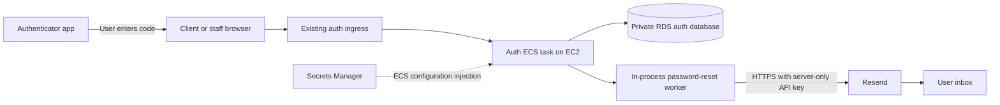

# How MFA and Resend work in Asset Avengers

A team explanation of login, authenticator enrollment, recovery and emailed
password reset. Checked against the application code and non-secret AWS
configuration flags on October 30, 2026.

## 1. The important distinction

**MFA uses an authenticator app. Resend delivers password-reset email.** They solve
different problems, even though both screens ask the user to enter six digits.

| Mechanism | Who produces the code? | What it proves | What success permits |
| --- | --- | --- | --- |
| Authenticator MFA | The user's authenticator app, using its enrolled secret and time | Possession of the enrolled factor, after password verification | Finish the appropriate login/enrollment/replacement flow |
| MFA recovery code | Auth generates a set when enrollment/replacement completes; the user stores it | Possession of an unused backup factor | Supported login or replacement proof |
| Password-reset email code | Auth generates a random code; Resend transports it | Access to the requested account's inbox | Obtain a short-lived grant to choose a new password |

The emailed reset code is **not** our authenticator MFA code. Resend does not
generate the TOTP secret, validate authenticator codes, assign roles or issue
application sessions. Resetting a password does not remove enrolled MFA.

The shared NestJS auth service owns these decisions for the client, admin and
analyst applications. The project does not use Cognito or Firebase for this flow.

## 2. Where the components run

- Angular displays forms, enrollment QR codes and recovery codes when appropriate.
- Same-origin /auth requests pass through the existing CloudFront/backend ingress
  to the auth ECS task on EC2, published on port 3000.
- The auth task reads/writes the private RDS logical database named auth.
- The task receives its secret configuration through ECS references to
  matrix/production/credentials in Secrets Manager.
- A background email worker runs **inside the auth process**. It is not the Kafka
  reporting publisher, Python reporting job, a separate ECS email service or SQS.
- That worker calls Resend over outbound HTTPS. Resend handles the email delivery
  attempt to the recipient's mail system.

The client and staff origin paths differ in the recorded AWS deployment; see the
[cloud architecture explanation](asset-avengers-cloud-deployment-story.md).
The frontend's old container Nginx files are not necessarily the active host proxy.



## 3. Which accounts require MFA?

The server's normal policy is:

- A plain CLIENT account can choose MFA at signup. If not opted in and not
  enrolled, password-only login is allowed.
- Once an authenticator is enrolled, it is required for a new login even if an
  older preference flag is false.
- ANALYST, ADMIN and SUPER_ADMIN require MFA under the normal policy.
- Accounts outside the single plain-CLIENT exception require MFA by default;
  adding an unfamiliar role does not automatically permit password-only access.
- Disabled accounts are refused after correct password proof. A provisioned
  account marked password_change_required must replace its temporary password
  before receiving a normal session or starting enrollment.

There is also a **temporary explicit dev exception**, described in section 10.
Do not describe every deployed staff login as a physical MFA verification while
that exception is active for an allowlisted identity.

Policy lives in [access-policy.ts](../auth-server/src/auth/access-policy.ts),
[auth.service.ts](../auth-server/src/auth/auth.service.ts) and the final
[session checks](../auth-server/src/auth/sessions.repository.ts).

## 4. Login and enrollment, step by step

1. The user submits email/password to POST /auth/login.
2. Auth checks the password with bcrypt. Unknown emails and incorrect passwords
   receive the same invalid-credentials response; bcrypt comparison still runs.
3. Auth checks disabled status and any required temporary-password change.
4. When MFA is required, password proof alone returns a restricted challenge,
   not normal access/refresh tokens.
5. An unenrolled required user receives an enrollment challenge and QR/manual
   secret. The authenticator scans/imports it and generates a code locally.
6. The user submits the challenge token and code to the matching MFA endpoint.
7. Auth verifies the code, prevents replay, consumes the challenge and creates
   the session in the appropriate database transaction.
8. Successful enrollment returns recovery codes once. The user must save them.

The QR/manual secret necessarily appears on the authorized enrollment screen.
It is not an application-wide secret baked into the JavaScript bundle. QR codes,
manual secrets and recovery codes must not be included in screenshots or logs.

```mermaid
sequenceDiagram
    participant U as User and browser
    participant A as Auth service
    participant D as Auth database
    participant T as Authenticator app
    U->>A: Email and password
    A->>D: Check identity and MFA state
    A-->>U: Restricted login or enrollment challenge
    opt Enrollment required
        U->>T: Scan QR or import enrollment secret
    end
    T-->>U: Time-based code
    U->>A: Challenge token and code
    A->>D: Verify and consume proof; create session atomically
    A-->>U: Access and refresh tokens; recovery codes on enrollment
```

### Code handling and replay protection

MFA challenges expire after **five minutes** by the auth schema default. The
service requires an unconsumed challenge of the expected purpose and permits
fewer than five recorded attempts before refusing further verification.

Authenticator input is six digits. Verification uses otplib with 30 seconds of
epoch tolerance and tracks the last accepted time step so the same accepted TOTP
step cannot simply be reused. Repeated failures can lock MFA verification for
five minutes. This is separate from the HTTP route/IP throttle.

The flow locks the auth user/state rows. Consuming a valid second factor and
creating its resulting session are coordinated so a failed session operation
rolls back the proof consumption instead of stranding the user.

## 5. Recovery and replacing a phone

Enrollment or successful replacement generates **10 recovery codes**. Each is a
random 16-character hexadecimal value. The database stores hashes, not a readable
copy of the recovery list. A code is single-use and is consumed transactionally.

The normal replacement sequence is:

1. Re-prove email/password and begin replacement.
2. Prove the old authenticator or an unused recovery code.
3. Receive a new enrollment QR/manual secret.
4. Prove a code generated from the new secret.
5. Activate the replacement, replace the recovery-code set and revoke old sessions.

The working authenticator is retained until the new secret is proved. The service
does not support casually disabling an enrolled authenticator; the disable routes
reject the request and direct the user toward replacement.

Losing both the authenticator and all recovery codes requires a separately reviewed,
identity-verified support process. The current email password-reset mechanism
cannot be used as a shortcut to disable MFA.

## 6. What the database and tokens store

| Auth table | Purpose | Sensitive material handling |
| --- | --- | --- |
| users | Identity, bcrypt password hash, roles, MFA preference and account flags | Passwords are hashed; roles are assigned by server policy |
| user_mfa | Enrolled secret, accepted time step and lock/failure state | TOTP secret is encrypted with AES-256-GCM |
| mfa_challenges | Restricted enrollment/login/replacement challenges | Opaque tokens are hashed; pending replacement secrets are encrypted |
| mfa_recovery_codes | Backup-factor usage | Recovery codes are hashed and tracked as used |
| sessions / refresh_tokens | Revocation, expiration and MFA proof | Refresh tokens are stored as hashes; session records carry mfa_verified_at |
| password_reset_requests | Request/code proof and the later reset grant | Codes use keyed hashes; request and grant tokens are hashed |
| auth_email_outbox | Durable pending delivery jobs and provider outcome | Recipient/code payload is encrypted, then cleared after terminal handling |

MFA encryption uses a base64-encoded **32-byte MFA_ENCRYPTION_KEY**, AES-256-GCM,
a fresh IV and an authentication tag. The user ID is bound as authenticated data
for authenticator secrets; reset outbox payloads are bound to the reset request ID.
The same configured key also supplies the keyed hashing material used by the
password-reset service.

Preserve this key across restarts, restores and container replacements. Blindly
replacing it can make existing MFA secrets and pending encrypted emails unreadable
and invalidate reset-code verification. Rotation requires a deliberate migration
or recovery plan, not just changing an environment variable.

Access JWTs carry authentication-method claims, including pwd and mfa when the
server establishes that proof. Refresh rotates the opaque refresh token and does
not create fresh MFA proof or extend the staff proof window indefinitely. Staff
sessions use an eight-hour MFA window in the current code. Backend guards and
session creation enforce policy; a frontend checkbox cannot certify MFA.

These auth tables and secrets do not flow through the trading outbox, Kafka,
reporting datasets or Superset. The trading and staff APIs verify the application
tokens; they do not need the user's TOTP secret.

## 7. Password reset and Resend, step by step

1. The user chooses Forgot password and submits an email to
   POST /auth/forgot-password.
2. Auth creates a random six-digit reset code and opaque request token. The
   response is generic for existing/unknown addresses. Disabled accounts are
   treated like unknown addresses for delivery: no email job is created.
3. For an eligible account, the reset request and encrypted outbox job are saved
   together. The HTTP request does not wait for Resend's network call.
4. The in-process worker leases a pending job, decrypts its recipient/code in
   memory and calls the Resend SDK.
5. The user reads the email and submits the code with the request token to
   POST /auth/verify-reset-code.
6. Valid proof consumes the code and returns a separate **five-minute reset grant**.
7. POST /auth/reset-password accepts that grant and the chosen new password.
8. Auth changes the bcrypt password hash, clears a temporary-password flag where
   applicable, revokes sessions, invalidates outstanding reset work and deletes
   outstanding MFA challenges. It preserves the enrolled authenticator and recovery codes.
9. The user signs in again with the new password and required MFA.

The reset code expires **10 minutes after the request**, not 10 minutes after the
email finally arrives. It allows at most five verification attempts. New accepted
requests invalidate older outstanding reset work for that account.

The reset grant is not an access JWT and cannot call trading/staff APIs. Neither
an emailed code nor a completed password reset automatically logs the user in.
New passwords must meet the code's 12-character minimum and 72 UTF-8-byte maximum.
Reusing the current password is rejected without consuming an otherwise valid
reset grant, allowing the user to choose a different password.

### Throttling

The reset service enforces a one-minute per-email cooldown and a maximum of three
requests per 15 minutes, using keyed email hashes for known and unknown accounts.
A rejected resend returns an explicit 429/RESET_REQUEST_LIMIT rather than giving
the UI a fresh unusable request token. The UI preserves the current request after
that failure.

Controllers also use the configured 20-request-per-15-minute route/IP throttle.
The effective real-client IP depends on proxy configuration. Auth currently trusts
one proxy hop; the CloudFront-plus-Nginx staff path needs to be considered when
assessing that behavior. Do not assume this setting alone proves correct per-user
rate limiting behind every ingress path.

### Delivery worker and retries

- The worker starts with the auth application outside NODE_ENV=test and checks
  pending work every **five seconds**. There is no extra email container to start.
- A database statement leases a job for 60 seconds using row locking and
  SKIP LOCKED. Network I/O does not hold a long-lived database transaction.
- The Resend call has a **12-second timeout** and a stable idempotency key based
  on the reset request ID, helping retries refer to the same email operation.
- Network errors, rate limits, selected concurrency errors and server errors
  are retryable. Permanent configuration/authentication errors are not.
- Retry scheduling respects provider Retry-After where available and the code's
  bounded exponential backoff. A job receives at most **five delivery attempts**.
- Expired/consumed/verified requests are cleaned up instead of sending obsolete
  codes. Terminal handling clears the encrypted payload.

A Resend response containing a message ID means the provider **accepted** the
send. The application's sent_at is not proof that a message arrived in an inbox.
This code does not establish delivered/bounced status through a Resend webhook.
The provider dashboard or an authorized inbox test is separate evidence.

## 8. Resend configuration and template modes

| Setting | Role |
| --- | --- |
| RESEND_API_KEY | Server-only credential used by the running auth service to send mail |
| EMAIL_FROM | Required nonempty sender identity |
| EMAIL_RESET_TEMPLATE_ID | Optional published remote template; blank selects plain-text mode |
| RESEND_SETUP_API_KEY | Optional management credential for the separate one-time setup helper |
| MFA_ENCRYPTION_KEY | Encrypts MFA/outbox material and supplies reset-service keyed hashing |
| JWT_SECRET | Separate application token-signing secret; not a Resend API key |

When a remote template is configured, the application sends the CODE and
EXPIRES_MINUTES variables. Without one, EmailService sends the built-in plain-text
password-reset message. Both modes follow the same reset/authentication policy.

The separate auth-server/scripts/setup-resend.mjs can create/check/publish the
remote template and write its ID into root .env. It is a provisioning helper,
not an auth startup step and not automatically an AWS deployment. It may require
management permissions that the running sender does not need.

The service handles Resend's restricted test-sender error separately. A missing
key, invalid key, unauthorized sender or recipient restriction is not repaired
by weakening MFA or resetting the auth database. For real intended recipients,
use the provider-authorized sender/domain configuration. A demo address at
example.com is display data, not a mailbox created by this application; the
seeded demo logins are disabled and are not sent reset mail.

### AWS configuration snapshot

A read-only check on October 30 found:

- Resend key and sender settings were present; their values were not printed.
- The MFA encryption key had the required decoded length.
- The running task selected **plain-text email mode**, not a remote template.
- NODE_ENV was production, so the in-process delivery worker is enabled.
- The dev MFA bypass flag was enabled for its explicit allowlist.

These checks establish configuration presence/mode, not validity of the provider
key, current sender-domain verification, successful inbox delivery or a fresh
end-to-end MFA login. No email or password reset was triggered for this document.

Changing a local .env file does not update the running ECS task. The legacy
startup helper can overwrite .env from Secrets Manager and is guarded on the
ECS-managed host. Follow the [current operations guide](../deployment/ecs/README.md)
for a reviewed secret/configuration deployment. Do not run the old Compose startup
helper or the Resend setup helper as a routine cloud restart.

## 9. Relevant endpoints

| Endpoint | Purpose |
| --- | --- |
| POST /auth/login | Password proof; return session, MFA challenge or required password change |
| POST /auth/change-temporary-password | Choose a personal password before continuing sign-in |
| POST /auth/mfa/setup | Begin enrollment after credential proof |
| POST /auth/mfa/enable | Prove the enrollment code and receive recovery codes |
| POST /auth/mfa/verify | Complete an MFA login challenge |
| POST /auth/mfa/replace/start | Begin replacement after credential proof |
| POST /auth/mfa/replace/verify | Prove old authenticator/recovery and receive replacement enrollment |
| POST /auth/mfa/replace/enable | Prove the replacement authenticator |
| POST /auth/forgot-password | Create restricted reset work and return a generic response |
| POST /auth/verify-reset-code | Exchange email/request proof for a reset grant |
| POST /auth/reset-password | Set a new password with the verified grant |
| POST /auth/refresh | Rotate the refresh token under session policy |
| POST /auth/logout | Revoke the current session |

Challenge tokens, reset grants and application tokens serve different purposes.
One cannot be substituted for another merely because it is a long random string.

## 10. The temporary dev MFA exception

DEV_MFA_BYPASS defaults false in source. When explicitly enabled, the allowlist is
limited to dev.superadmin@example.com, dev.admin@example.com and
dev.analyst@example.com. It does not match every address starting with dev and
it does not include the 200 renamed demo clients.

The exception is checked in both login and final session creation. Correct
password proof, disabled-account checks and temporary-password restrictions still
apply. The source marks this as temporary/local-development behavior. Its current
AWS setting is recorded above so the team can distinguish the deployed exception
from the normal staff MFA requirement. This documentation did not change it.

## 11. How this is tested

| Suite | What it checks |
| --- | --- |
| mfa.service.spec.ts | Enrollment, code/recovery replay, replacement and concurrent/rollback behavior with the configured disposable DB |
| sessions.repository.spec.ts | Final session policy and the narrow dev exception |
| dev-mfa-bypass.spec.ts | Allowlisted identities versus ordinary users and disabled/temporary-password restrictions |
| password-reset.service.spec.ts | Code/grant lifecycle, expiry, throttling, password reuse, session revocation and preservation of MFA |
| email.service.spec.ts | SDK payload, template/plain-text modes, idempotency and error/retry classification using simulated HTTP responses |
| Staff Playwright journey | Selected actual browser login/MFA/SSO behavior against an isolated service stack |

Tests use generated fixture secrets and simulated email sending. A passing SDK
mock test does not prove that a real recipient received mail. Database suites must
use disposable databases; never point MFA_TEST_DATABASE_URL at shared RDS.
See the [test tools and coverage guide](tests-coverage-and-tools.md) for reports,
coverage responsibilities and CI boundaries.

## 12. Troubleshooting without exposing secrets

| Symptom | Inspect first |
| --- | --- |
| MFA verification is required | Enrollment/policy, challenge purpose and final session enforcement; not an email-code problem |
| Authenticator code rejected | Correct account/QR, device/server time, challenge expiry, replay and lock state |
| MFA encryption key is not configured | Presence/decoded length of the existing key; do not blindly generate a replacement |
| Forgot-password response but no email | Generic response is not delivery proof; check eligibility, outbox state and worker/provider outcome |
| Email worker inactive | Auth task health, production/test mode and private sanitized logs |
| EMAIL_NOT_CONFIGURED / RESEND_HTTP_401 | Sender credential configuration and authorization |
| RESEND_TEST_RECIPIENT_RESTRICTED | Provider test-sender/recipient restriction; use the intended verified sender setup |
| RESEND_HTTP_429 | Provider Retry-After, request volume and pending-code expiry |
| Code expired before arrival | The 10-minute lifetime begins at request time; inspect delivery delays |
| RESET_REQUEST_LIMIT | Keep the existing request/code and honor the one-minute/15-minute rules |
| Password reset succeeded but MFA still requested | Expected: enrolled MFA is preserved |

A safe aggregate query, run in the auth database, can inspect queue state without
printing recipients, codes, ciphertexts, hashes or tokens:

```sql
SELECT current_database(), current_user;
SELECT
  count(*) FILTER (WHERE sent_at IS NOT NULL) AS provider_accepted,
  count(*) FILTER (WHERE sent_at IS NULL AND failed_at IS NULL) AS pending,
  count(*) FILTER (WHERE sent_at IS NULL AND failed_at IS NOT NULL) AS terminal_unsent
FROM auth_email_outbox;
```

Terminal unsent rows can include expiry/cancellation after verification, not just
provider delivery failures. Use last_error_code and sanitized worker logs to
interpret them. Do not paste raw database rows, QR codes, email payloads,
credentials, access/refresh tokens or recovery codes into chat or Git.

## Source references

- [Authentication policy](../auth-server/src/auth/access-policy.ts)
- [Login and session issuance](../auth-server/src/auth/auth.service.ts)
- [Authenticator cryptography and state machine](../auth-server/src/auth/mfa.service.ts)
- [Session enforcement](../auth-server/src/auth/sessions.repository.ts)
- [Password reset and delivery worker](../auth-server/src/auth/password-reset.service.ts)
- [Resend adapter](../auth-server/src/auth/email.service.ts)
- [Routes](../auth-server/src/auth/auth.controller.ts)
- [Auth schema](../DB/auth_db.schema.sql)
- [Configuration validation](../auth-server/src/config/env.ts)
- [One-time Resend template setup](../auth-server/scripts/setup-resend.mjs)
- [Temporary dev exception](../auth-server/src/auth/dev-mfa-bypass.ts)
- [Detailed MFA guide](mfa.md) and [email API guide](email-service.md)
- [Cloud startup guide](start-asset-avengers-on-aws.md)
