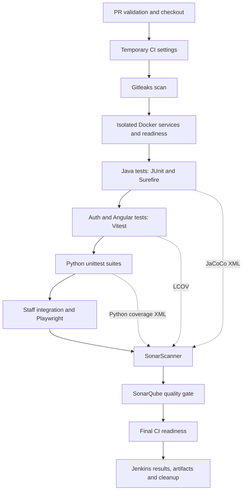

# Asset Avengers: tests, coverage reports and tool responsibilities

This is the team guide to how tests run, what their reports mean, and which tool
is responsible for each step. Checked against the repository on October 30, 2026.

The [detailed test inventory](testing-guide.md) lists individual suites. The
[Jenkins guide](jenkins-ci.md) explains CI setup and isolation. This document
connects those details into one workflow.

## 1. The short explanation

**Jenkins coordinates the job. Test runners execute assertions. Coverage tools
record which code ran. SonarQube imports coverage and applies its quality gate.
Jenkins publishes the available test results, coverage artifacts and logs.**

For example, a Java test can assert that buying stock subtracts the correct cash.
JUnit runs that assertion, Maven launches the suite, JaCoCo records the Java code
executed, and SonarQube combines the JaCoCo report with code analysis. Jenkins
shows the test outcome and retains the generated reports.

A passing test and high coverage answer different questions:

- **Tests:** did the assertions pass for the scenarios we exercised?
- **Coverage:** which instrumented lines, branches or functions were executed?
- **Quality gate:** did the scanned project meet the policy configured on the
  team's SonarQube server?
- **Readiness:** can a service respond and reach its required dependencies now?

None alone proves every user journey or the live AWS deployment is correct.

## 2. Which tool does what?

| Tool | Responsibility in this repository | Output / boundary |
| --- | --- | --- |
| Git and Jenkins PR integration | Supply the proposed code change and supported PR metadata | Source checkout; Git is not a test runner |
| Jenkins | Orders stages, supplies CI credentials, captures failures, publishes results and cleans up | Build status, stage logs, Tests page and artifacts |
| Bash / Python CI helpers | Implement the commands Jenkins calls and enforce isolation/failure handling | scripts/ci-tests.sh, ci-checks.sh and ci-compose.sh |
| Docker / Docker Compose | Supply predictable runtimes, temporary databases, Kafka and test services | Isolated CI containers, volumes and networks |
| Maven | Builds Java code, resolves dependencies and invokes Java test/coverage plugins | backend/target and internal-backend/target |
| JUnit / Spring Test | Execute Java assertions and selected controller/security/database tests | Test outcomes; JUnit itself does not measure coverage |
| Mockito and controlled collaborators | Replace selected Java dependencies so tests can isolate a rule | Useful isolation; not proof that an external service works |
| Maven Surefire | Discovers/runs Maven test-phase suites and writes Java test reports | target/surefire-reports/TEST-*.xml and text reports |
| JaCoCo | Instruments Java execution and creates coverage reports | target/site/jacoco/jacoco.xml and HTML index.html |
| npm | Installs lockfile dependencies and invokes Node/Angular test scripts | Command execution; npm is not the assertion or coverage engine |
| Vitest | Runs authentication and Angular test cases | Console results and JUnit-compatible XML in CI |
| Angular CLI test builder | Builds/configures the Angular unit-test execution | Calls the configured test tooling; UI tests are distinct from real browser journeys |
| V8 coverage provider | Measures executed JavaScript/TypeScript during Vitest tests | LCOV and terminal coverage summary |
| Python unittest | Runs Python pipeline and CI guard test cases | Console test results and exit status |
| coverage.py | Measures Python execution, including branch coverage configured in .coveragerc | coverage/python/coverage.xml |
| Playwright / Chromium | Drives selected staff authentication journeys in a real browser | Browser JUnit XML and masked failure screenshots |
| PostgreSQL | Supplies real SQL behavior for configured disposable database tests | Database integration evidence; no coverage percentage by itself |
| H2 / test doubles where configured | Supply lightweight Java test dependencies | Different behavior from production PostgreSQL; database-specific tests still matter |
| Gitleaks | Scans Git history for possible committed secrets | Redacted gitleaks-output.txt; not functional test coverage |
| SonarScanner | Sends source, Java build metadata and existing coverage files to SonarQube | sonar-output.txt and scan submission |
| SonarQube | Analyzes code, displays imported coverage and evaluates its assigned quality gate | Quality dashboard and gate result; it does not execute our application tests |
| Jenkins JUnit publisher | Reads compatible XML files from several runners | Jenkins Tests view, counts, failures and trends |
| Trivy / ECR image scanning | Separate recorded container/dependency assessment workflows | Deployment verification records; not a stage currently present in Jenkinsfile |

**JUnit XML is a report format as well as the name of a Java testing ecosystem.**
Vitest and Playwright can write JUnit-compatible reports without becoming Java
JUnit tests. Jenkins uses that common format to display their results together.

## 3. The actual CI order

The source of truth is [Jenkinsfile](../Jenkinsfile), with commands in
[ci-checks.sh](../scripts/ci-checks.sh) and [ci-tests.sh](../scripts/ci-tests.sh).

1. **Validate Pull Request:** reject unsupported jobs/routes before using shared
   credentials or Docker resources.
2. **Checkout:** obtain the proposed source revision and clear stale reports.
3. **Generate Temporary CI Settings:** create disposable database/password/key
   settings for this job, rather than using shared RDS credentials.
4. **Git Leaks Scan:** run Gitleaks with redacted output.
5. **Initialize Isolated CI Environment:** create a unique Compose project.
6. **Start Database:** start and verify the temporary trading database.
7. **Build and Start Services:** build the client stack and wait for readiness.
8. **Java Tests and Coverage:** run Maven for trading and internal APIs.
9. **Authentication and UI Tests:** run auth, client Angular and staff Angular suites.
10. **Pipeline and CI Guard Tests:** run the configured Python suites with coverage.
11. **Build Staff and Reporting Images:** build staff API/UI, pipeline and Superset.
12. **Staff Integration and Browser Authentication:** run the isolated real-service
    verifier and the selected Playwright browser journey.
13. **SonarQube Analysis:** require coverage files, submit analysis and wait for the gate.
14. **Verify Service Readiness:** recheck the CI services.
15. **Post-build handling:** collect available diagnostics, clean up owned temporary
    resources, publish JUnit reports and archive coverage/logs. Send notifications
    when the job's configured recipients and conditions permit.



The diagram shows the normal flow. Cleanup/report collection also run after
failures where their prerequisites exist. Gitleaks has a deliberate exception:
a finding or scanner error marks the build failed, but later checks may continue
to collect evidence. Normal required test/build failures stop subsequent normal
stages. Do not interpret later successful stages as cancelling an earlier failure.

**This Jenkins pipeline validates changes; it does not deploy production.**
ECR/ECS and S3/CloudFront publishing are separate workflows in this repository.
A test image built in Jenkins is not automatically the image running on AWS.

## 4. What each application layer tests

| Layer | Location | Representative behavior checked | Important limit |
| --- | --- | --- | --- |
| Trading Java API | backend/src/test | Order validation/execution, cash and holdings, ownership, returns, quote cache, security and readiness | Provider responses are controlled in relevant unit tests; a pass is not a live market-data guarantee |
| Staff Java API | internal-backend/src/test | Admin/analyst access, staff queries, portfolio filtering, schedules, exports and Superset integration contracts | Mocked collaborators and test database behavior do not replace a cloud end-to-end test |
| Auth | auth-server/src/**/*.spec.ts | Password changes, MFA, sessions, resets, email handling, staff rules and SSO tickets | DB suites require the disposable MFA_TEST_DATABASE_URL; real inbox delivery is not established |
| Client Angular | frontend/src/**/*.spec.ts | Portfolio refresh, return calculations, accounts, orders, forms, navigation and error states | Controlled HTTP/time/state tests are not actual financial transactions |
| Staff Angular | internal-frontend/src/**/*.spec.ts | Staff screens, requests, authorization-related rendering and reporting interactions | Separate from Playwright's browser journey |
| Reporting Python units | admin-analytics/pipeline/tests/test_*.py | Report schedules, reporting logic exercised by those tests and dashboard configuration | Discovery does not execute every script in the directory |
| CI guard Python units | scripts/tests/test_ci*.py | Ownership checks, cleanup boundaries, pipeline wiring, errors and report validation | Many replace Docker/tool commands with controlled fakes |
| Staff stack integration | scripts/verify-admin-stack.py and admin-analytics/pipeline/tests/ | Selected real Kafka delivery, projections, report publication, HTTP permissions and Superset query behavior | Synthetic fixtures in isolated databases, not all production users/data |
| Staff browser auth | internal-frontend/tests/auth-journey.e2e.ts | Selected actual login/MFA/SSO, session and browser-routing behavior | A selected journey, not every browser feature or client trading workflow |
| Readiness probes | scripts/ci-checks.sh | Containers and dependency-aware service readiness | Does not prove every application-table permission or business rule |

The auth e2e configuration in auth-server/vitest.config.e2e.ts is separate from
the normal Vitest configuration. The Jenkins auth command does not independently
invoke npm run test:e2e. Python files such as integration.py, stack-check.py and
http-check.py have explicit verifier entry points; they are not all automatically
included by unittest's test_*.py pattern.

The standalone Superset SSO tests under admin-analytics/superset/tests are also
not part of the two Python unittest discovery roots in ci-python-tests.sh. Some
related behavior is tested by staff integration/browser checks; do not claim
that every standalone suite is a mandatory Jenkins stage without checking its caller.

### Example: the portfolio return bug

The client regression test supplies a $5,000 purchase while its market quote is
still pending. It checks that the UI does not display a fabricated -$5,000 loss.
Other assertions check retained quotes, portfolio readiness, displayed asset count
and Overview refresh after an asynchronous fill.

This catches a specific frontend bug without placing real orders or changing
RDS. Covering the return-calculation line without asserting the correct result
would be weaker evidence. The relevant tests are in
[portfolio.store.spec.ts](../frontend/src/app/client/state/portfolio.store.spec.ts)
and [app.spec.ts](../frontend/src/app/app.spec.ts).

## 5. Test reports versus coverage reports

A **test report** records cases, outcomes, duration and errors. A **coverage
report** records execution of source code. They are generated by different tools.

| Module / suite | Runner | Test-results file | Coverage file used by Sonar |
| --- | --- | --- | --- |
| Trading API | Maven / JUnit / Surefire | backend/target/surefire-reports/TEST-*.xml | backend/target/site/jacoco/jacoco.xml |
| Staff API | Maven / JUnit / Surefire | internal-backend/target/surefire-reports/TEST-*.xml | internal-backend/target/site/jacoco/jacoco.xml |
| Auth | Vitest | auth-server/test-results/junit.xml | auth-server/coverage/lcov.info |
| Client Angular | Angular / Vitest | frontend/test-results/junit.xml | frontend/coverage/frontend/lcov.info |
| Staff Angular | Angular / Vitest | internal-frontend/test-results/junit.xml | internal-frontend/coverage/staff/lcov.info |
| Python units/guards | unittest | Console results; no dedicated JUnit XML from this command | coverage/python/coverage.xml |
| Staff browser | Playwright | internal-frontend/test-results/browser/junit.xml | No browser source-coverage report configured here |

Those are the configured CI paths. A runner's output folder may depend on its
project name/configuration; verify the artifacts from the specific build.

Java coverage also includes a browsable HTML report at
backend/target/site/jacoco/index.html or internal-backend/target/site/jacoco/index.html.
The current JavaScript CI commands request LCOV and terminal text summaries;
they do not explicitly request an HTML coverage report. Python CI writes XML;
it does not explicitly generate a Python HTML report.

### Metrics and how to read them

- **Passed / failed / skipped tests:** outcomes, not coverage percentages. A skipped
  PostgreSQL-specific test did not pass against PostgreSQL in that run.
- **Line coverage:** proportion of executable lines reported as executed.
- **Branch coverage:** whether alternatives such as true/false and error paths
  were exercised. High line coverage can still leave branches untested.
- **Function/method coverage:** whether reported functions/methods ran; it does not
  prove every input combination is correct.
- **Overall coverage:** the analyzer's coverage of the included measured code.
- **New-code coverage:** coverage of code SonarQube considers new under its configured
  baseline. It can differ substantially from overall coverage.

Example: 80 covered executable lines out of 100 means 80% line coverage. That is
an explanation of the metric, **not a measured Asset Avengers coverage figure**.
Do not average module percentages without their denominators, or mix branch and
line totals into an invented overall score. Sonar's displayed coverage metric and
its imported report totals should be interpreted with the selected project scope.

No fixed 80% threshold is imposed by the checked test commands or by the Jenkins
scanner arguments. The assigned SonarQube quality gate controls acceptance; inspect
that gate for its actual conditions. The job waits up to 300 seconds for the gate.
A red gate can result from conditions besides coverage.

## 6. How coverage reaches SonarQube

1. Maven tests execute under JaCoCo. Its report goal writes Java XML/HTML in the
   Maven test phase. A failed early test phase may leave some reports missing.
2. Auth and Angular tests run with Vitest coverage enabled. The V8 provider writes
   LCOV; CI also requests a terminal coverage summary.
3. ci-lcov.cjs checks LCOV files and makes source paths repository-relative with
   the module prefix. This prevents frontend/src and internal-frontend/src from
   being confused during analysis. It fails on missing/invalid source paths.
4. coverage.py runs the configured Python discovery commands, appending their
   execution data, and writes coverage/python/coverage.xml. The .coveragerc file
   enables branch measurement and defines source/omit paths.
5. ci-checks.sh sonar requires **six nonempty coverage files**: two JaCoCo XML,
   three LCOV and one Python XML. Missing required files stop the scan.
6. SonarScanner submits source, Java compiled classes/dependencies and those
   reports. Tests, test results, coverage folders and build/dependency directories
   are excluded from its production-source scope as configured in that command.
7. SonarQube analyzes the submission and returns its assigned quality-gate result.

SonarQube does not generate missing test execution data by scanning source. It
cannot manufacture coverage for a skipped suite. A green scanner upload is also
not sufficient if the subsequent gate is rejected or times out.

The Python measured source includes scripts and admin-analytics, while the
configured discovery runs only selected suites. Unexecuted included Python source
can therefore reduce reported coverage. Broader-looking source scope is not a
promise that every module received a dedicated test.

## 7. Where to find the results

Open the relevant Jenkins build, not a report from a different commit.

- **Console Output / stage view:** locate the first failed stage and its actual
  error. Avoid treating the last printed cleanup command as the cause.
- **Tests page:** Jenkins imports Java Surefire, Node/Angular JUnit and browser
  JUnit files. Check failures and skipped cases as well as the headline count.
- **Archived artifacts:** Java HTML coverage, coverage folders, browser artifacts
  and CI logs that were available when post-build handling ran.
- **SonarQube project asset-avengers:** inspect coverage, uncovered source and the
  actual quality-gate conditions for the analyzed revision.

Useful diagnostic artifacts include gitleaks-output.txt, services-output.txt,
sonar-output.txt, readiness-output.txt, ci-docker-logs.txt, staff-build-output.txt,
staff-integration-output.txt and staff-docker-logs.txt.

The Jenkins JUnit step allows empty results so an early setup failure can still
be reported and cleaned up. **Empty results do not mean all tests passed.** The
Sonar preflight's nonempty-report checks are a separate requirement. Likewise,
archived historical reports do not prove the latest source revision was tested.

Browser CI uses masked failure screenshots. Raw tracing/video are disabled in its
configuration because authentication journeys handle sensitive session material.
Do not share raw logs or artifacts containing credentials or personal data.

## 8. Running tests locally

For quick client UI regression checks, from frontend with compatible Node/npm and
installed dependencies:

```bash
npm test -- --watch=false --include='src/app/client/state/portfolio.store.spec.ts'
```

For the client suite with the configured CI report formats:

```bash
npm ci
npm run test:ci
```

Run the equivalent npm commands from internal-frontend for the staff Angular suite.
An optional production build is a separate packaging check:

```bash
npm run build
```

A successful build is not a passing test suite, and plain npm test without the
coverage option is not a fresh coverage run.

For a Java module, from backend or internal-backend:

```bash
mvn test
```

Confirm its active test configuration and disposable database requirements first.
Jenkins uses a controlled Maven/JDK container and additionally supplies its
isolated PostgreSQL URL to the trading test invocation. Some opt-in PostgreSQL
suites have separate helpers, such as scripts/run-backend-postgres-tests.py;
inspect their requirements rather than assuming mvn test runs every DB scenario.

For the full containerized CI actions, Jenkins calls these helpers **after** it
has generated temporary CI settings, initialized CI_PROJECT_NAME and verified the
temporary databases. These are pipeline commands, not production-startup commands:

```bash
bash scripts/ci-tests.sh java
bash scripts/ci-tests.sh auth
bash scripts/ci-tests.sh web
bash scripts/ci-tests.sh python
```

Never point MFA_TEST_DATABASE_URL, pricing test JDBC settings, the staff verifier
or fixture-loading scripts at the shared AWS RDS databases. Tests may deliberately
truncate or recreate their disposable data. Do not copy production .env values
into a test job. Use the setup procedures in the [Jenkins guide](jenkins-ci.md).

## 9. CI evidence versus AWS verification

| Evidence | What it establishes | What still needs a separate check |
| --- | --- | --- |
| Unit tests | Selected rules with controlled dependencies | Real network/provider/browser behavior |
| Database integration tests | Selected interactions with the configured test database | RDS networking, restored ownership and live service permissions |
| Staff integration/browser checks | Selected multi-service/authentication journeys | Every production workflow and every browser/device |
| Coverage | Execution of included source in that run | Correct assertions, complete requirements and all possible inputs |
| Gitleaks | Results of its configured secret scan | Every possible exposure or runtime log leak |
| Sonar gate | Compliance with the assigned analysis policy | Deployment correctness and availability |
| Runtime smoke checks | Reachability and selected reads at the recorded time | Actual authenticated signup/login, transfers and orders unless explicitly tested |

Production read-only smoke-test records are under
[deployment/ecs/verification](../deployment/ecs/verification/). They are distinct
from Jenkins unit/integration coverage and do not increase the CI coverage score.

For example, an unauthenticated HTTP 401 from a protected AWS endpoint proves
routing and access rejection. It does not prove a valid user can finish login.
A healthy container does not prove that it can select every required application
object. We verify those concerns separately.

The separate Trivy/ECR records describe point-in-time image/dependency checks.
Do not add them to the Jenkins stage list merely because they were used during
AWS deployment. Similarly, a successful Jenkins job does not automatically push
an image to ECR, update ECS, upload Angular files to S3 or invalidate CloudFront.

## 10. How to present an honest test/coverage report

For a team update or presentation, record:

1. Commit/revision, build number, date and environment.
2. Which suites actually ran, with passed/failed/skipped counts.
3. Coverage by module, the metric used and the exact report/build it came from.
4. SonarQube gate status and the configured conditions that passed or failed.
5. Integration/browser scenarios tested, with their boundaries.
6. Any required suites that were skipped, blocked or not run.
7. Runtime/deployment checks separately from CI results.

Use wording such as: “Jenkins ran the Java, auth, Angular and selected Python
suites in disposable containers. JaCoCo, V8 and coverage.py generated coverage;
SonarQube imported it and evaluated the quality gate. Playwright checked the
selected staff authentication journey. AWS production checks were performed
separately.”

Do not report a current project coverage percentage without the actual recent
reports. This documentation review did not run a full Jenkins build or query the
team's SonarQube server, so it establishes the configured workflow rather than a
new measured project-wide coverage result.

## Source references

- [Jenkins stages and publication](../Jenkinsfile)
- [Test runner orchestration](../scripts/ci-tests.sh)
- [Auth database test setup](../scripts/ci-auth-tests.sh)
- [Python coverage execution](../scripts/ci-python-tests.sh)
- [Scans, coverage requirements and readiness](../scripts/ci-checks.sh)
- [LCOV source normalization](../scripts/ci-lcov.cjs)
- [Java coverage configuration](../backend/pom.xml) and [staff API configuration](../internal-backend/pom.xml)
- [Auth Vitest configuration](../auth-server/vitest.config.ts)
- [Browser CI configuration](../internal-frontend/playwright.ci.config.ts)
- [Python coverage scope](../.coveragerc)
- [Detailed test inventory](testing-guide.md)
- [Jenkins setup and limitations](jenkins-ci.md)
